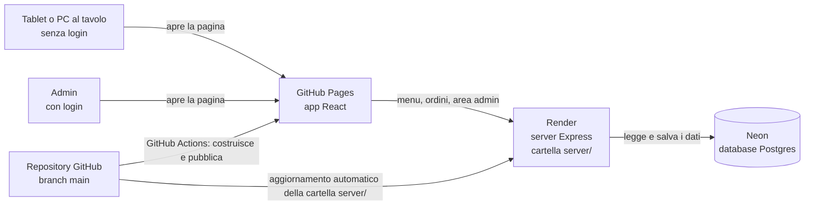
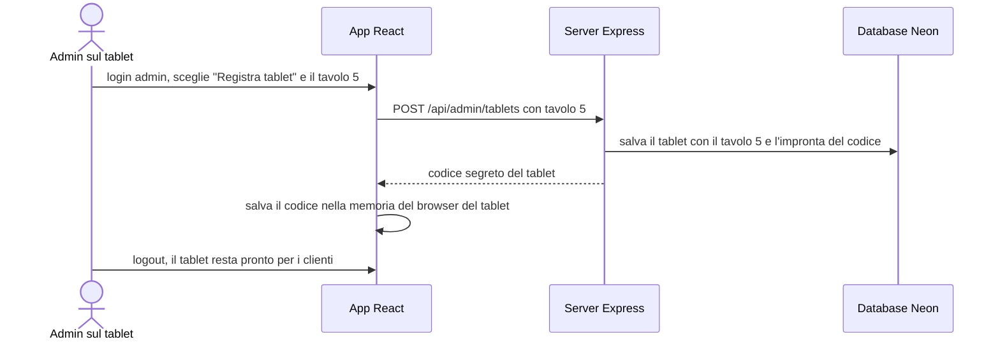
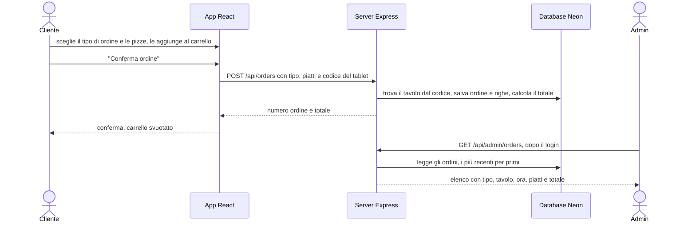
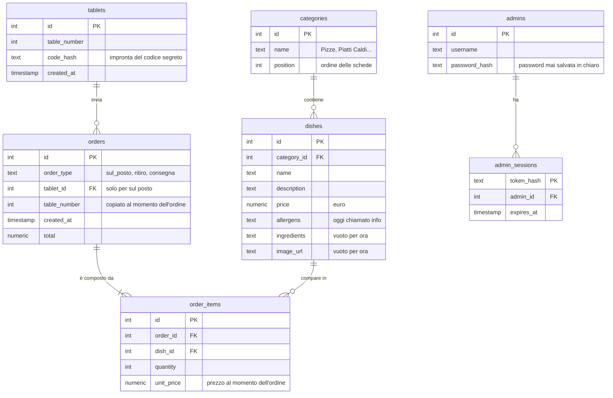

# Piano: RestaurantManager con server, database e area admin

Data: 22/10/2026 · Stato: approvato il 22/10/2026, fase 1 in corso

## Contesto

Oggi RestaurantManager è solo l'interfaccia grafica (React): i piatti sono scritti a mano nel codice (`src/Components/Tab/Tab.js:9-103`) e gli ordini restano in memoria finché la pagina è aperta (`src/Pages/Home/Home.js:8`), poi spariscono.
**Obiettivo**: progetto personale di prova che riproduce un ristorante vero (non destinato alla vendita). Clienti al tavolo **senza account**, un'**area admin con login** che mostra gli ordini e il tavolo da cui arrivano, scelta del tipo di ordine (sul posto, ritiro, consegna). Si parte dalla grafica per PC con le pizze; poi la versione responsive per smartphone e tablet; immagini e ingredienti arriveranno dopo.
**Vincoli**: costo zero; l'app resta su GitHub Pages e si collega a un server e a un database gratuiti.

## Architettura

- **GitHub Pages** ospita solo file statici: l'app si apre subito, i dati arrivano dal server su Render.
- **Render gratuito** spegne il server dopo 15 minuti senza visite e ci mette circa un minuto a ripartire: in quel minuto l'app mostra un messaggio di caricamento.
- **Render** cancella i file del server a ogni spegnimento: per questo il database sta su **Neon** (Postgres gratuito, senza scadenza, 1 GB).
- App e server hanno due indirizzi diversi, quindi servono la regola **CORS** (l'elenco dei siti autorizzati a chiamare il server) e il login admin con un **token** inviato a ogni richiesta, invece del cookie (i browser bloccano sempre più spesso i cookie tra siti diversi).
- Le regole di GitHub Pages sconsigliano di usarlo per inviare password. Qui la password admin viaggia verso Render, non verso GitHub, e il sito è una prova personale: va bene così. Se un giorno diventasse un servizio vero, l'app andrebbe spostata insieme al server.

## Come il tablet conosce il suo tavolo

L'idea dell'indirizzo IP non funziona con il server online: tutti i dispositivi nello stesso Wi-Fi escono su internet con l'IP del router, quindi il server li vede tutti uguali. Al suo posto ogni tablet viene **registrato una volta** dall'admin.

- Nel database non si salva il codice ma la sua "impronta" (hash, una trasformazione da cui non si risale al codice).
- Se qualcuno cancella i dati del browser del tablet, il codice si perde e il tablet va registrato di nuovo dall'area admin.
- Gli ordini "Mangia sul posto" senza un codice tablet valido vengono rifiutati: questo blocca anche gli ordini finti mandati da fuori.

## Come funziona un ordine e cosa vede l'admin

- Il totale lo calcola il server con i prezzi del database, non lo accetta dall'app.
- Il numero del tavolo viene copiato nell'ordine: se domani il tablet cambia tavolo, gli ordini vecchi restano giusti.
- Il tipo di ordine (Mangia sul posto / Ritira / Consegna) oggi viene scelto ma non è usato (`src/Components/DropdownField/DropdownField.js:27`): dalla fase 1 viene mostrato nel carrello e poi salvato con l'ordine. Quali dati chiedere per "Ritira" e "Consegna" è una decisione aperta (vedi in fondo).

## Dati salvati

- `ingredients` e `image_url` nascono vuoti: servono per quando aggiungerai ingredienti e foto.
- La password admin è trasformata con `scrypt`, già incluso in Node: nessuna libreria in più.
- Il primo admin si crea una volta sola con un piccolo script lanciato dal PC.
- Per "Ritira" e "Consegna" potrebbero servire altri campi (nome, telefono, indirizzo): si aggiungono quando decidi la domanda aperta.

## Servizi del server (API)

| Indirizzo | Cosa fa | Chi può usarlo |
|---|---|---|
| `GET /api/health` | risponde "ok": serve a capire se il server è sveglio | tutti |
| `GET /api/categories` | elenco delle categorie | tutti |
| `GET /api/dishes?category=N` | piatti di una categoria | tutti |
| `POST /api/orders` | salva un ordine e restituisce numero e totale | tutti; "sul posto" solo da tablet registrati |
| `POST /api/admin/login` e `/logout` | entrata e uscita admin | admin |
| `GET /api/admin/orders` | ordini con tipo, tavolo, ora, piatti, totale | admin |
| `GET` / `POST` / `DELETE /api/admin/tablets` | elenca, registra e rimuove tablet | admin |

## Fasi di lavoro

Dopo ogni fase mi fermo: tu provi e mi dai la conferma prima di passare alla successiva. Commit diretti su `main`, solo dopo la tua conferma.

| Fase | Cosa si fa | Chi | Stima indicativa |
|---|---|---|---|
| 1. Grafica PC | scheda Pizze con 8 pizze di esempio (ancora scritte nel codice), schede vuote nascoste, carrello con quantità e totale, tipo di ordine nel carrello, "Conferma ordine", correzione del bug "Maggiori info", pagina iniziale che apre il menu | io | 3-4 h |
| 2. Account | creare gli account gratuiti su Neon e Render e collegare Render a GitHub | tu | 15 min |
| 3. Database e server | tabelle su Neon, server Express, le pizze passano dal codice al database | io | 3-4 h |
| 4. Tablet e tavoli | registrazione dei tablet e tavolo automatico negli ordini | io | 2-3 h |
| 5. Area admin | login, pagina ordini, pagina tablet, script per il primo admin | io | 4-5 h |
| 6. Responsive | adattamento a smartphone e tablet | io | 3-4 h |
| 7. Online | server su Render, app su GitHub Pages collegata al server | io + tu | 1-2 h |

Totale indicativo: circa tre giorni di lavoro, esclusi i tuoi test.

## Tabella impatti

| File | Tipo | Complessità | Fase | Cosa cambia |
|---|---|---|---|---|
| `src/Components/Tab/Tab.js` | modifica | media | 1, 3 | pizze di esempio al posto dei piatti attuali (righe 9-103), schede vuote nascoste; poi lettura dal server |
| `src/Components/Card/Card.js` | modifica | bassa | 1 | il clic su "Maggiori info" non aggiunge più il piatto al carrello (righe 13-17); pulsante "Aggiungi" |
| `src/Components/DropdownField/DropdownField.js` | modifica | bassa | 1 | comunica l'opzione scelta a chi la usa (oggi resta interna, riga 27) |
| `src/Components/Orders/Orders.js` | modifica | media | 1, 3, 4 | il pannello oggi è vuoto e fa solo `console.log` (riga 9): mostra piatti, quantità, totale, tipo di ordine e "Conferma ordine" |
| `src/Pages/Home/Home.js` | modifica | bassa | 1 | gestione del carrello (aggiungi, togli, conferma) e del tipo di ordine |
| `Card.css`, `Tab.css`, `Orders.css` | modifica | media | 1, 6 | grafica delle card con pizza disegnata in CSS e del carrello; poi responsive |
| `src/App.js` | modifica | bassa | 1, 5, 7 | la pagina iniziale `/` apre il menu (oggi è vuota, riga 11); pagine admin; `HashRouter` per GitHub Pages |
| `src/api.js` | nuovo | bassa | 3 | funzioni che chiamano il server, indirizzo preso da `REACT_APP_API_URL` |
| `.env.development` | nuovo | bassa | 3 | indirizzo del server sul PC, nessun segreto |
| `package.json` | modifica (1 riga) | bassa | 7 | campo `homepage` con l'indirizzo GitHub Pages, senza il quale l'app online non carica |
| `.github/workflows/deploy.yml` | nuovo | bassa | 7 | costruisce l'app e la pubblica su GitHub Pages a ogni push su main |
| `server/package.json` | nuovo | bassa | 3 | dipendenze del server: `express` (server), `pg` (collegamento a Postgres), `cors` (permessi tra siti) |
| `server/index.js` | nuovo | media | 3, 4, 5 | avvio del server e servizi API |
| `server/db.js` | nuovo | bassa | 3 | collegamento al database tramite `DATABASE_URL` |
| `server/auth.js` | nuovo | media | 4, 5 | controllo del codice tablet e del token admin |
| `server/db/schema.sql`, `server/db/seed.sql` | nuovi | bassa | 3 | tabelle, categorie e pizze iniziali |
| `server/scripts/create-admin.js` | nuovo | bassa | 5 | crea il primo admin |
| `src/Pages/Admin/` (login, ordini, tablet) | nuovi | media | 5 | le tre pagine dell'area admin |
| `.gitignore` | modifica (1 riga aggiunta) | bassa | 3 | esclude `server/.env`, dove sta la password del database sul PC |

Punti di attenzione richiesti dalla stima:

| Tocca | Sì/No | Dettaglio |
|---|---|---|
| API o contratti tra servizi | sì | nascono i servizi della tabella API |
| Schema del database | sì | database nuovo, 7 tabelle |
| Configurazioni di deploy e variabili d'ambiente | sì | `DATABASE_URL` e indirizzo di GitHub Pages (per CORS) su Render, `REACT_APP_API_URL` nella costruzione su GitHub Actions, `homepage` nel package.json, impostazione Pages del repository |
| Test esistenti | no | l'unico test (`src/App.test.js:4-8`) cerca il testo "learn react", che nell'app non esiste: **fallisce già oggi** (verificato il 22/10/2026). Non lo tocco |

## Note e rischi

- **Attesa dopo una pausa**: con Render gratuito, dopo 15 minuti senza visite la prima richiesta aspetta circa un minuto; l'app mostra un messaggio di caricamento.
- **Password del database**: `DATABASE_URL` sta solo nelle impostazioni di Render e in `server/.env` sul PC, mai su GitHub né nell'app. Le variabili `REACT_APP_...` finiscono dentro l'app e chiunque può leggerle: lì va solo l'indirizzo del server.
- **Codice tablet perso**: se si cancellano i dati del browser del tablet, va registrato di nuovo.
- **HashRouter**: GitHub Pages non sa gestire indirizzi come `/Orders` quando si ricarica la pagina (errore 404). Con `HashRouter` l'indirizzo diventa `.../#/Orders` e funziona sempre.
- **Limiti gratuiti**: Neon 1 GB, Render 750 ore al mese; se si supera il traffico gratuito Render sospende il servizio fino a fine mese. Render dichiara che il piano gratuito non è per la produzione: per una prova va bene. Offerte verificate il 22/10/2026.
- **Versione di Node su Render**: il server userà Node 22 come sul PC; come fissarla su Render lo verifico nella fase 7.
- **Fuori da questo piano**: ricerca, pagina Impostazioni, foto dei piatti, gestione del menu dall'area admin, stati dell'ordine (nuovo, in preparazione, servito), icone del menu laterale sempre bianche.

## Decisioni

| # | Domanda | Decisione (22/10/2026) |
|---|---|---|
| 1 | Pizze di esempio | le scelgo io: 8 classiche con prezzi indicativi |
| 2 | Schede vuote | nascoste finché non hanno piatti |
| 3 | Tendina "Mangia sul posto / Ritira / Consegna" | resta e va gestita: il tipo scelto finisce nell'ordine |
| 4 | Nome "Wellness Pizza" (`src/Pages/Home/Home.js:23`) | resta |
| 5 | Dispositivi | prima la grafica per PC, poi responsive per smartphone e tablet |
| 6 | Git | commit diretti su `main` |
| 7 | Hosting | l'app resta su GitHub Pages e si collega al server su Render |
| 8 | Dati da chiedere per "Ritira" e "Consegna" (nome, telefono, indirizzo, orario?) | **aperta**, da decidere prima della fase 3 |

## Fonti (verificate il 22/10/2026)

- [GitHub Pages, cos'è](https://docs.github.com/en/pages/getting-started-with-github-pages/what-is-github-pages) e [limiti d'uso](https://docs.github.com/en/pages/getting-started-with-github-pages/github-pages-limits)
- [GitHub Actions gratis per repository pubblici](https://docs.github.com/en/billing/concepts/product-billing/github-actions)
- [Render, piano gratuito](https://render.com/docs/free) e [cartella del servizio (Root Directory)](https://render.com/docs/monorepo-support)
- [Neon, prezzi e piano gratuito](https://neon.com/pricing)
- [Create React App, pubblicazione su GitHub Pages](https://create-react-app.dev/docs/deployment/) e [variabili d'ambiente](https://create-react-app.dev/docs/adding-custom-environment-variables/)
- [React Router, HashRouter](https://reactrouter.com/6.30.1/router-components/hash-router)
