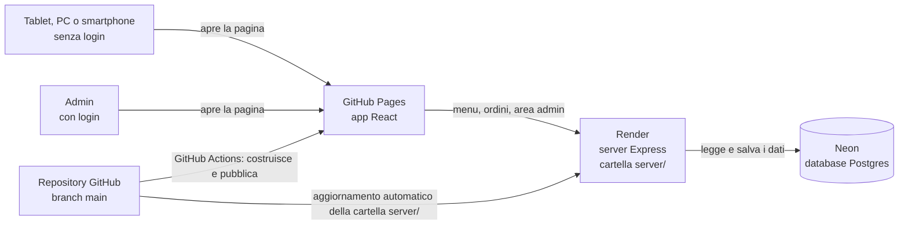
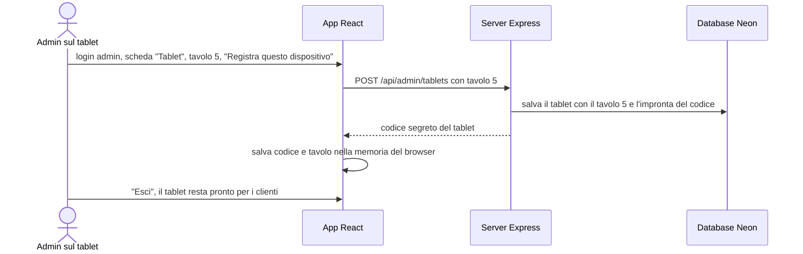
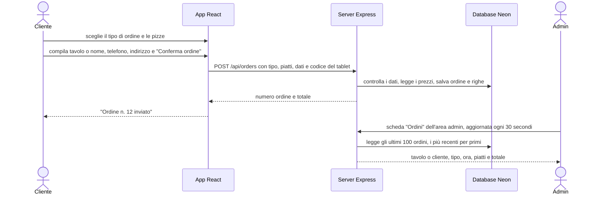
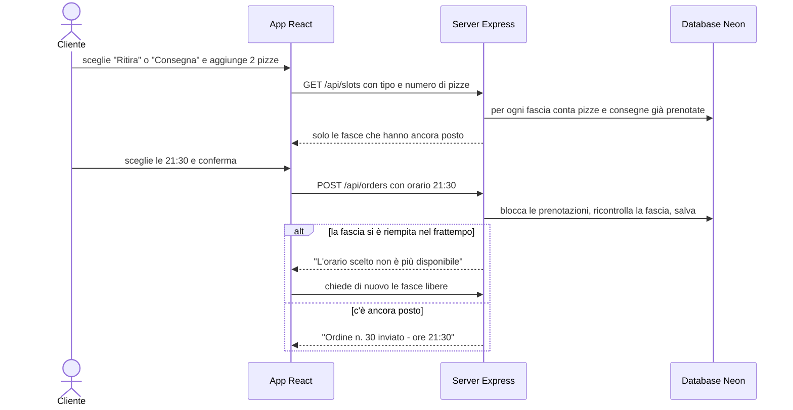
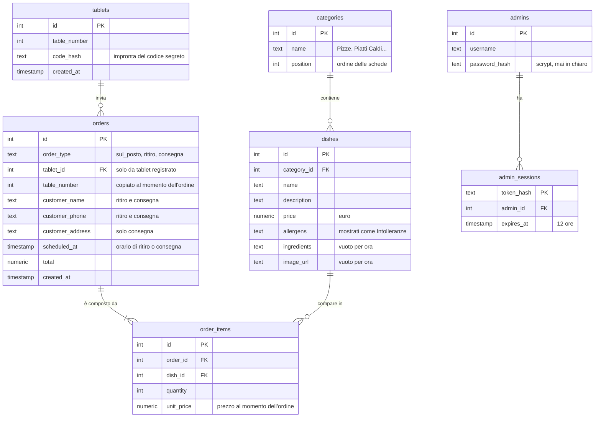

# RestaurantManager: server, database, tavoli e area admin

Data: 22/10/2026 · Stato: fasi 1, 3, 4, 5, 6 fatte e provate in locale; fasi 2 e 7 (account e messa online) da fare insieme

## Contesto

Prima di questo lavoro RestaurantManager era solo l'interfaccia grafica (React): piatti scritti a mano nel codice e ordini che sparivano chiudendo la pagina.
**Obiettivo**: progetto personale di prova che riproduce un ristorante vero (non destinato alla vendita). Clienti al tavolo **senza account**, un'**area admin con login** che mostra gli ordini e il tavolo da cui arrivano, scelta del tipo di ordine (sul posto, ritiro, consegna), grafica per PC, smartphone e tablet.
**Vincoli**: costo zero; l'app resta su GitHub Pages e si collega a un server e a un database gratuiti.

## Architettura

- **GitHub Pages** ospita solo file statici: l'app si apre subito, i dati arrivano dal server su Render (`.github/workflows/deploy.yml`).
- **Render gratuito** spegne il server dopo 15 minuti senza visite e ci mette circa un minuto a ripartire: in quel minuto l'app mostra "Il server si sta avviando" (`src/Pages/Home/Home.js:30-44`).
- **Neon** (Postgres gratuito, senza scadenza, 1 GB) conserva i dati, perché Render cancella i file del server a ogni spegnimento.
- App e server hanno indirizzi diversi: il server accetta chiamate solo dai siti elencati in `ALLOWED_ORIGINS` (regola **CORS**, `server/index.js:49`) e il login admin usa un **token** inviato a ogni richiesta invece del cookie.
- Il server crea da solo le tabelle mancanti e carica il menu iniziale se il database è vuoto (`server/db.js:31-37`): su Neon non serve lanciare niente a mano.

## Come il tablet conosce il suo tavolo

Con il server online l'indirizzo IP non distingue i tablet (dallo stesso Wi-Fi escono tutti con l'IP del router). Al suo posto ogni tablet viene **registrato una volta** dall'admin, dal tablet stesso.

- Nel database c'è solo l'"impronta" del codice (hash), non il codice (`server/index.js:303-315`).
- Su un dispositivo **non registrato** chi sceglie "Mangia sul posto" scrive il numero del tavolo a mano (`src/Components/Orders/Orders.js`). È la richiesta iniziale ("inserire il numero tavolo, o in automatico"): il piano precedente prevedeva di rifiutare questi ordini, ma così si può provare tutto anche dal PC.
- Se l'admin rimuove un tablet, al suo ordine successivo il server risponde "non più registrato", l'app dimentica il codice e chiede il tavolo a mano (`src/api.js:109-113`).
- Se si cancellano i dati del browser del tablet, va registrato di nuovo.

## Come funziona un ordine e cosa vede l'admin

| Tipo di ordine | Dati richiesti al cliente |
|---|---|
| Mangia sul posto | niente se il tablet è registrato, altrimenti il numero del tavolo |
| Ritira | nome, telefono e orario di ritiro scelto da un elenco |
| Consegna | nome, telefono, indirizzo e orario di consegna scelto da un elenco |

- Il numero del tavolo esiste solo per "Mangia sul posto": per ritiro e consegna il server lo ignora e salva l'orario.

## Orari di ritiro e consegna

| Regola | Valore (22/10/2026) |
|---|---|
| Fasce orarie | dalle 19:00 alle 23:00, ogni 15 minuti, solo per oggi, ora italiana |
| Preavviso minimo | la prima fascia proposta è almeno 30 minuti dopo l'ora attuale |
| Forno | al massimo 6 pizze per fascia, contando ritiri e consegne insieme |
| Fattorino | al massimo 1 consegna per fascia |

- Le fasce piene non compaiono: chi ordina 2 pizze vede solo le fasce dove ne restano almeno 2 nel forno; per la consegna anche quelle dove il fattorino è libero (`server/slots.js:17-37`).
- Due ordini che arrivano nello stesso istante per l'ultimo posto vengono controllati uno alla volta: ne passa uno solo, l'altro riceve "orario non più disponibile" (`server/index.js:189-206`). Provato il 22/10/2026 con due richieste contemporanee.
- Con più di 6 pizze nessuna fascia è possibile: l'app scrive di chiamare la pizzeria.
- Gli ordini "Mangia sul posto" non occupano le fasce.
- I valori della tabella sono costanti in `server/slots.js:4-13`: per cambiarli (per esempio 2 fattorini) si modifica quel file.
- Dopo le 22:30 non ci sono più fasce per la serata: per provare ritiro e consegna serve farlo prima.
- Il totale lo calcola il server con i prezzi del database (`server/index.js:170-186`).

## Dati salvati

- Tabelle in `server/db/schema.sql`, menu iniziale (8 pizze con prezzi indicativi) in `server/db/seed.sql`.
- `ingredients` e `image_url` sono pronti per quando aggiungerai ingredienti e foto; l'app per ora non li mostra.
- Per cambiare pizze e prezzi oggi si modifica il database (per esempio dall'editor SQL di Neon): la gestione del menu dall'area admin è fuori da questo lavoro.

## Servizi del server (API)

| Indirizzo | Cosa fa | Chi può usarlo |
|---|---|---|
| `GET /api/health` | risponde "ok" e sveglia il database | tutti |
| `GET /api/menu` | categorie con almeno un piatto, ognuna con i suoi piatti | tutti |
| `GET /api/slots?type=ritiro&dishes=2` | fasce orarie ancora libere per quel tipo e quel numero di pizze | tutti |
| `POST /api/orders` | salva un ordine e restituisce numero e totale | tutti |
| `POST /api/admin/login` e `/logout` | entrata e uscita admin | admin |
| `GET /api/admin/orders` | ultimi 100 ordini con tavolo o cliente, tipo, ora, piatti, totale | admin |
| `GET` / `POST` / `DELETE /api/admin/tablets` | elenca, registra e rimuove tablet | admin |

Rispetto al piano iniziale `GET /api/categories` e `GET /api/dishes` sono diventati un solo `GET /api/menu`: una sola chiamata, utile quando il server si sta svegliando.

## Fasi di lavoro

| Fase | Cosa si fa | Stato |
|---|---|---|
| 1. Grafica PC | 8 pizze, card con pizza disegnata in CSS, carrello con quantità e totale, tipo di ordine, bug "Maggiori info" corretto | fatta |
| 2. Account | account gratuiti su Neon e Render | **da fare (tu)** |
| 3. Database e server | server Express, tabelle, menu dal database | fatta, provata con un database Postgres locale |
| 4. Tablet e tavoli | registrazione tablet, tavolo automatico o scritto a mano | fatta |
| 5. Area admin | login, ordini, tablet, script per creare l'admin | fatta |
| 6. Responsive | smartphone: menu in basso, carrello a tutto schermo con barra "Vedi ordine"; tablet verticale e orizzontale | fatta |
| 7. Online | server su Render, app su GitHub Pages | **da fare insieme**: file pronti, servono gli account |

Prove fatte il 22/10/2026 su PC (1440x900), smartphone (390x844), tablet verticale (820x1180) e orizzontale (1180x820): ordine al tavolo scritto a mano, consegna, errore senza tavolo, login sbagliato e giusto, registrazione tablet, ordine con tavolo automatico, ordine visto dall'admin. Le API sono state provate anche con dati sbagliati (tavolo mancante, telefono non valido, piatto inesistente, codice tablet falso, CORS da un sito non autorizzato).

## Come provarlo sul PC

| Passo | Comando o azione |
|---|---|
| 1 | in `server/` copiare `.env.example` in `.env` e mettere in `DATABASE_URL` l'indirizzo del database Neon |
| 2 | in `server/`: `npm install`, poi `npm run create-admin -- <nome> <password>` (password di almeno 8 caratteri) |
| 3 | in `server/`: `npm run dev` (server su `http://localhost:4000`) |
| 4 | nella cartella principale: `npm start` (app su `http://localhost:3000`, legge l'indirizzo del server da `.env.development`) |

## Come metterlo online

| Passo | Dove | Cosa fare |
|---|---|---|
| 1 | neon.com | creare il progetto e copiare la "connection string" |
| 2 | PC | creare l'admin sul database Neon con il passo 2 della tabella sopra |
| 3 | render.com | New > Web Service > repository RestaurantManager; Root Directory `server`; Build Command `npm ci`; Start Command `npm start`; piano Free |
| 4 | Render > Environment | `DATABASE_URL` = connection string di Neon; `ALLOWED_ORIGINS` = `https://josecontis.github.io` |
| 5 | GitHub > Settings > Pages | Source: "GitHub Actions" |
| 6 | GitHub > Settings > Secrets and variables > Actions > Variables | `API_URL` = indirizzo del servizio Render (senza `/` finale) |
| 7 | PC | `git push` su main: GitHub Actions pubblica l'app su `https://josecontis.github.io/RestaurantManager/` |

La versione di Node su Render è fissata a 22 dal campo `engines` di `server/package.json`.

## Tabella impatti

| File | Tipo | Cosa cambia |
|---|---|---|
| `src/Components/Tab/Tab.js` | modifica | schede e piatti arrivano dal server; tipi di ordine presi da `src/api.js`; filtro della ricerca su categoria, nome, descrizione e ingredienti, senza distinguere maiuscole e accenti |
| `src/Components/SearchField/SearchField.js` | modifica | il campo di ricerca comunica il testo scritto (prima non era collegato a niente) |
| `src/Components/Card/Card.js` | modifica | pulsante "Aggiungi", prezzo in euro, "Maggiori info" non aggiunge più il piatto |
| `src/Components/DropdownField/DropdownField.js` | modifica | comunica l'opzione scelta |
| `src/Components/Orders/Orders.js` | modifica | carrello, campi per tavolo o cliente, invio, conferma, barra "Vedi ordine" su smartphone |
| `src/Pages/Home/Home.js` | modifica | carica il menu, gestisce carrello, tipo di ordine e invio |
| `src/Pages/Admin/` (4 file `.js` + `Admin.css`) | nuovi | area admin: login, ordini, tablet |
| `src/api.js` | nuovo | tutte le chiamate al server e la memoria del browser (tablet e admin) |
| `src/App.js` | modifica | `HashRouter`, `/` apre il menu, rotta `/Admin` |
| `src/Components/Sidebar/Sidebar.js` | modifica | la voce "Settings" diventa "Admin"; l'icona attiva segue l'indirizzo |
| file `.css` di Card, Tab, Orders, Home, Sidebar, SearchField, DropdownField, Modal | modifica | grafica nuova e regole per smartphone e tablet; il popup "Maggiori info" resta visibile anche scorrendo |
| `package.json` | modifica (1 riga) | `"homepage": "."`, necessario per GitHub Pages |
| `.env.development` | nuovo | indirizzo del server sul PC |
| `.github/workflows/deploy.yml` | nuovo | pubblicazione su GitHub Pages a ogni push su main |
| `.gitignore` | modifica (3 righe aggiunte) | esclude `server/node_modules` e `server/.env` |
| `server/` (`index.js`, `db.js`, `auth.js`, `slots.js`, `db/schema.sql`, `db/seed.sql`, `scripts/create-admin.js`, `package.json`, `.env.example`) | nuovi | server, database, login admin, tablet, fasce orarie |

| Tocca | Sì/No | Dettaglio |
|---|---|---|
| API o contratti tra servizi | sì | i servizi della tabella API |
| Schema del database | sì | database nuovo, 7 tabelle |
| Configurazioni di deploy e variabili d'ambiente | sì | `DATABASE_URL`, `ALLOWED_ORIGINS` su Render; `API_URL` su GitHub; `homepage`; workflow GitHub Actions |
| Test esistenti | no | l'unico test (`src/App.test.js:4-8`) cerca "learn react" e **fallisce già da prima** di questo lavoro. Non l'ho toccato |

## Note e rischi

- **Prima visita lenta**: dopo 15 minuti senza visite il server su Render impiega circa un minuto a ripartire.
- **Password**: `DATABASE_URL` solo su Render e in `server/.env` (escluso da git). La password admin passata a `npm run create-admin` resta nella cronologia del terminale: per una prova va bene.
- **Server pubblico**: chiunque conosca l'indirizzo può inviare ordini "sul posto" scrivendo un tavolo qualsiasi. Per una prova è accettabile; non c'è un limite di tentativi sul login admin.
- **Avviso React già presente**: la tendina (`src/Components/DropdownField/DropdownField.js:53`) genera un avviso in console per una `key` mancante; c'era già prima e non l'ho toccata. Per lo stesso tipo di avvisi preesistenti (variabili non usate in `Modal.js` e `Sidebar.js`) la pubblicazione usa `CI: false`, altrimenti si fermerebbe.
- **Limiti gratuiti**: Neon 1 GB, Render 750 ore al mese; Render dichiara che il piano gratuito non è per la produzione. Offerte verificate il 22/10/2026.
- **Fuori da questo lavoro**: foto dei piatti, gestione del menu dall'area admin, stati dell'ordine (nuovo, in preparazione, servito), icone del menu laterale sempre bianche.

## Decisioni

| # | Domanda | Decisione |
|---|---|---|
| 1 | Pizze di esempio | 8 classiche con prezzi indicativi, scelte da me |
| 2 | Schede vuote | nascoste finché non hanno piatti |
| 3 | Tendina "Mangia sul posto / Ritira / Consegna" | gestita: il tipo finisce nell'ordine |
| 4 | Nome "Wellness Pizza" | resta |
| 5 | Dispositivi | PC, smartphone e tablet |
| 6 | Git | commit diretti su `main` |
| 7 | Hosting | app su GitHub Pages collegata al server su Render |
| 8 | Dati per "Ritira" e "Consegna" | nome, telefono e orario da un elenco; per la consegna anche l'indirizzo |
| 9 | Ordine "sul posto" da dispositivo non registrato | si scrive il numero del tavolo (confermato) |
| 10 | Fasce orarie | 19:00-23:00 ogni 15 minuti, solo oggi, preavviso 30 minuti |
| 11 | Fattorino | 1 consegna per fascia |
| 12 | Forno | 6 pizze per fascia, ritiri e consegne insieme |

## Fonti (verificate il 22/10/2026)

- [GitHub Pages, limiti d'uso](https://docs.github.com/en/pages/getting-started-with-github-pages/github-pages-limits) e [workflow personalizzati](https://docs.github.com/en/pages/getting-started-with-github-pages/using-custom-workflows-with-github-pages)
- [GitHub Actions gratis per repository pubblici](https://docs.github.com/en/billing/concepts/product-billing/github-actions)
- [Render, piano gratuito](https://render.com/docs/free), [Root Directory](https://render.com/docs/monorepo-support) e [versione di Node](https://render.com/docs/node-version)
- [Neon, prezzi e piano gratuito](https://neon.com/pricing)
- [Create React App, pubblicazione](https://create-react-app.dev/docs/deployment/) e [variabili d'ambiente](https://create-react-app.dev/docs/adding-custom-environment-variables/)
- [React Router, HashRouter](https://reactrouter.com/6.30.1/router-components/hash-router)
