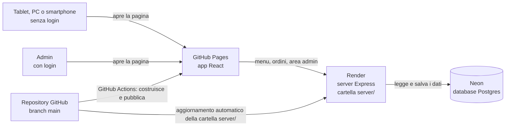
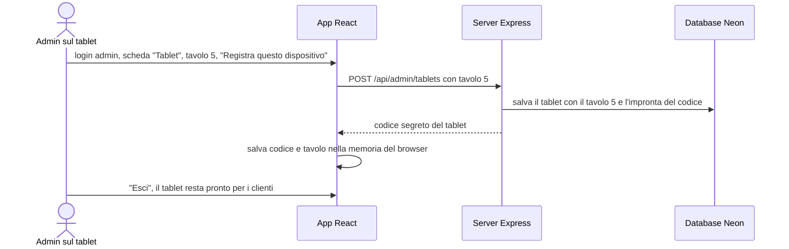
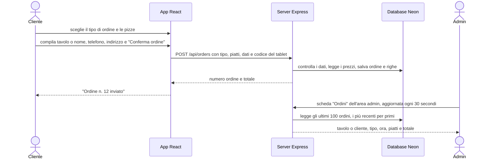
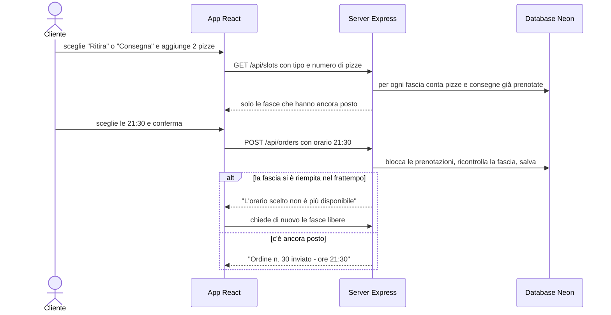
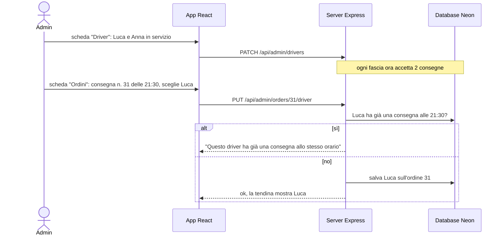
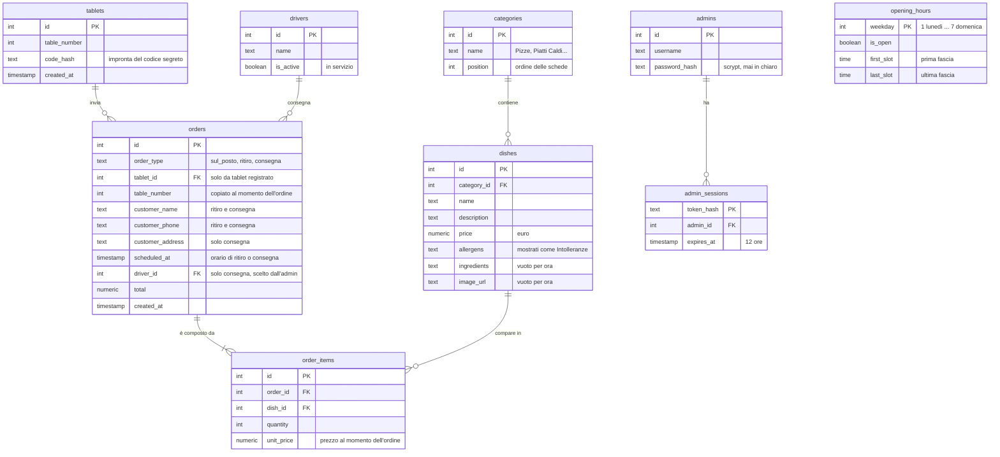
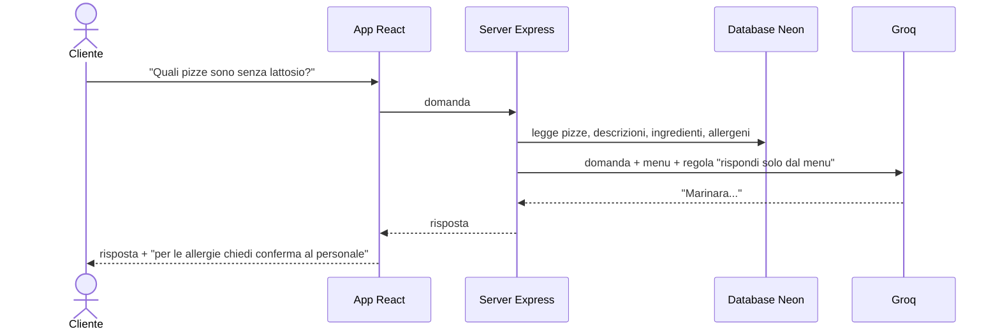

# RestaurantManager: server, database, tavoli e area admin

Data: 22/10/2026 · Stato: fasi 1, 3, 4, 5, 6, 8, 9 fatte e provate in locale; fasi 2 e 7 (account e messa online) da fare insieme

## Contesto

Prima di questo lavoro RestaurantManager era solo l'interfaccia grafica (React): piatti scritti a mano nel codice e ordini che sparivano chiudendo la pagina.
**Obiettivo**: progetto personale di prova che riproduce un ristorante vero (non destinato alla vendita). Clienti al tavolo **senza account**, un'**area admin con login** che mostra gli ordini e il tavolo da cui arrivano, scelta del tipo di ordine (sul posto, ritiro, consegna), grafica per PC, smartphone e tablet.
**Vincoli**: costo zero; l'app resta su GitHub Pages e si collega a un server e a un database gratuiti.

## Architettura

- **GitHub Pages** ospita solo file statici: l'app si apre subito, i dati arrivano dal server su Render (`.github/workflows/deploy.yml`).
- **Render gratuito** spegne il server dopo 15 minuti senza visite e ci mette circa un minuto a ripartire: in quel minuto l'app mostra "Il server si sta avviando" (`src/Pages/Home/Home.js:31-45`).
- **Neon** (Postgres gratuito, senza scadenza, 1 GB) conserva i dati, perché Render cancella i file del server a ogni spegnimento.
- App e server hanno indirizzi diversi: il server accetta chiamate solo dai siti elencati in `ALLOWED_ORIGINS` (regola **CORS**, `server/index.js:55`) e il login admin usa un **token** inviato a ogni richiesta invece del cookie.
- Il server crea da solo le tabelle mancanti e carica il menu iniziale se il database è vuoto (`server/db.js:31-37`): su Neon non serve lanciare niente a mano.

## Come il tablet conosce il suo tavolo

Con il server online l'indirizzo IP non distingue i tablet (dallo stesso Wi-Fi escono tutti con l'IP del router). Al suo posto ogni tablet viene **registrato una volta** dall'admin, dal tablet stesso.

- Nel database c'è solo l'"impronta" del codice (hash), non il codice (`server/index.js:445-457`).
- Su un dispositivo **non registrato** chi sceglie "Mangia sul posto" scrive il numero del tavolo a mano (`src/Components/Orders/Orders.js`). È la richiesta iniziale ("inserire il numero tavolo, o in automatico"): il piano precedente prevedeva di rifiutare questi ordini, ma così si può provare tutto anche dal PC.
- Se l'admin rimuove un tablet, al suo ordine successivo il server risponde "non più registrato", l'app dimentica il codice e chiede il tavolo a mano (`src/api.js:109-113`).
- Se si cancellano i dati del browser del tablet, va registrato di nuovo.

## Come funziona un ordine e cosa vede l'admin

| Tipo di ordine | Dati richiesti al cliente |
|---|---|
| Mangia sul posto | niente se il tablet è registrato, altrimenti il numero del tavolo |
| Ritira | nome, telefono e orario di ritiro scelto da un elenco |
| Consegna | nome, telefono, indirizzo e orario di consegna scelto da un elenco |

- Il numero del tavolo esiste solo per "Mangia sul posto": per ritiro e consegna il server lo ignora e salva l'orario.

## Orari di ritiro e consegna

| Regola | Valore (22/10/2026) | Chi la cambia |
|---|---|---|
| Fasce orarie | ogni 15 minuti, solo per oggi, ora italiana, tra la prima e l'ultima fascia del giorno della settimana; di base 19:00-23:00 tutti i giorni | admin, scheda "Orari" |
| Giorno di chiusura | nessuna fascia prenotabile | admin, scheda "Orari" |
| Preavviso minimo | la prima fascia proposta è almeno 30 minuti dopo l'ora attuale | codice |
| Forno | al massimo 6 pizze per fascia, contando ritiri e consegne insieme | codice |
| Driver | tante consegne per fascia quanti sono i driver in servizio | admin, scheda "Driver" |

- Le fasce piene non compaiono: chi ordina 2 pizze vede solo le fasce dove ne restano almeno 2 nel forno; per la consegna solo quelle con meno consegne dei driver in servizio (`server/slots.js:14-48`).
- Con **nessun driver in servizio** la consegna non ha fasce: il cliente legge "Nessun orario disponibile per oggi".
- Due ordini che arrivano nello stesso istante per l'ultimo posto vengono controllati uno alla volta: ne passa uno solo, l'altro riceve "orario non più disponibile" (`server/index.js:195-213`). Provato il 22/10/2026 con due richieste contemporanee.
- Con più di 6 pizze nessuna fascia è possibile: l'app scrive di chiamare la pizzeria.
- Gli ordini "Mangia sul posto" non occupano le fasce e non dipendono dagli orari.
- Durata della fascia, preavviso e capienza del forno sono costanti in `server/slots.js:3-9`: per cambiarli si modifica quel file.
- Da 30 minuti prima dell'ultima fascia del giorno non ci sono più fasce per la serata.
- Il totale lo calcola il server con i prezzi del database (`server/index.js:176-192`).

## Sottosezioni dell'area admin

| Scheda | Cosa fa | File |
|---|---|---|
| Ordini | ultimi 100 ordini, aggiornati ogni 30 secondi; sulle consegne una tendina per scegliere il driver | `src/Pages/Admin/AdminOrders.js` |
| Driver | aggiunge e rimuove driver, li mette o toglie dal servizio, mostra quanti sono in servizio | `src/Pages/Admin/AdminDrivers.js` |
| Orari | per ogni giorno: aperto o chiuso, prima e ultima fascia; si salva tutta la settimana insieme | `src/Pages/Admin/AdminHours.js` |
| Tablet | registra questo dispositivo su un tavolo, elenca e rimuove i tablet | `src/Pages/Admin/AdminTablets.js` |

- Un driver fa **una consegna per fascia**: nella tendina chi è già impegnato a quell'ora è grigio e non selezionabile, e il server lo rifiuta comunque (`server/index.js:301-338`, `src/Pages/Admin/AdminOrders.js:30-55`, `src/Pages/Admin/AdminOrders.js:86-92`).
- Nella tendina compaiono anche i driver non in servizio, con la scritta "(non in servizio)", per poterli usare in caso di imprevisti.
- Gli orari sono controllati dal server: ore valide e ultima fascia non prima della prima (`server/index.js:355-390`).
- Togliere un driver dal servizio non cambia le consegne già prenotate: diminuiscono solo i posti delle fasce ancora libere.

## Componenti riusabili

Regola dal 22/10/2026: se una schermata ha bisogno di un elemento che esiste già si usa lo stesso componente; se gli manca qualcosa gli si aggiunge un'opzione facoltativa, senza cambiare chi lo usa già.

| Componente | Cosa fa | Opzioni | Dove si usa |
|---|---|---|---|
| `Button` (`src/Components/Button/Button.js`) | pulsante | `variant`: "primary" (corallo) o "secondary" (scuro con bordo grigio); `className` per spazi e dimensioni decisi dalla pagina | carrello ("Conferma ordine", "Nuovo ordine", "Torna al menu"), "Riprova" del menu, tutte le schede admin |
| `TextField` (`src/Components/TextField/TextField.js`) | campo per testo, numero, telefono, password, orario | le stesse di un campo normale (`type`, `placeholder`, `value`...) | carrello (tavolo, nome, telefono, indirizzo), login admin, Driver, Orari, Tablet |
| `DropdownField` (`src/Components/DropdownField/DropdownField.js:6-13`) | tendina | `selectedIndex`: voce mostrata decisa da fuori; `disabledIndexes`: voci grigie non selezionabili; la larghezza la decide la pagina che la usa | tipo di ordine nel menu, driver sulle consegne |
| `ListRow` (`src/Components/ListRow/ListRow.js`) | riga di un elenco: titolo e nota a sinistra, pulsanti o campi a destra | `title`, `note`, contenuto a destra | schede Driver, Orari, Tablet |
| `useAdminError` (`src/Pages/Admin/useAdminError.js`) | messaggio d'errore delle schede admin; con la sessione scaduta torna al login | | schede Ordini, Driver, Orari, Tablet |

- Restano con uno stile proprio perché non sono pulsanti normali: la barra "Vedi ordine" su smartphone, i pulsanti +/- delle quantità, le fasce orarie del carrello, "Aggiungi" della card (fa parte della card cliccabile) e il campo di ricerca (ha l'icona e un suo stile).
- Cambi visibili: il testo dei campi del carrello passa da 14 a 15 px e il pulsante "Riprova" prende lo stile comune (un po' più stretto, con l'ombra). Il resto è uguale: confrontate le schermate prima e dopo su PC e smartphone.
- Prove del 22/10/2026 su PC e smartphone: ordine di ritiro completo, ordine al tavolo con e senza numero, "Torna al menu", login errato e giusto, driver assegnato e tolto dalla tendina, driver aggiunto, tolto dal servizio e rimosso, giorno chiuso e riaperto, tablet registrato e annullato, sessione scaduta che riporta al login. Nessun avviso in console.

## Dati salvati

- Tabelle in `server/db/schema.sql`, menu iniziale (8 pizze con prezzi indicativi) in `server/db/seed.sql`. I 7 giorni di `opening_hours` vengono creati all'avvio del server con l'orario 19:00-23:00 (`server/db/schema.sql:36-38`).
- Se si rimuove un driver, le sue consegne passate restano senza driver.
- `ingredients` e `image_url` sono pronti per quando aggiungerai ingredienti e foto; l'app per ora non li mostra.
- Per cambiare pizze e prezzi oggi si modifica il database (per esempio dall'editor SQL di Neon): la gestione del menu dall'area admin è fuori da questo lavoro.

## Servizi del server (API)

| Indirizzo | Cosa fa | Chi può usarlo |
|---|---|---|
| `GET /api/health` | risponde "ok" e sveglia il database | tutti |
| `GET /api/menu` | categorie con almeno un piatto, ognuna con i suoi piatti | tutti |
| `GET /api/slots?type=ritiro&dishes=2` | fasce orarie ancora libere per quel tipo e quel numero di pizze | tutti |
| `POST /api/orders` | salva un ordine e restituisce numero e totale | tutti |
| `POST /api/admin/login` e `/logout` | entrata e uscita admin | admin |
| `GET /api/admin/orders` | ultimi 100 ordini con tavolo o cliente, tipo, ora, driver, piatti, totale | admin |
| `PUT /api/admin/orders/:id/driver` | assegna o toglie il driver di una consegna | admin |
| `GET` / `PUT /api/admin/opening-hours` | legge e salva gli orari dei 7 giorni | admin |
| `GET` / `POST` / `PATCH` / `DELETE /api/admin/drivers` | elenca, aggiunge, mette in servizio o toglie, rimuove driver | admin |
| `GET` / `POST` / `DELETE /api/admin/tablets` | elenca, registra e rimuove tablet | admin |

Rispetto al piano iniziale `GET /api/categories` e `GET /api/dishes` sono diventati un solo `GET /api/menu`: una sola chiamata, utile quando il server si sta svegliando.

## Fasi di lavoro

| Fase | Cosa si fa | Stato |
|---|---|---|
| 1. Grafica PC | 8 pizze, card con pizza disegnata in CSS, carrello con quantità e totale, tipo di ordine, bug "Maggiori info" corretto | fatta |
| 2. Account | account gratuiti su Neon e Render | **da fare (tu)** |
| 3. Database e server | server Express, tabelle, menu dal database | fatta, provata con un database Postgres locale |
| 4. Tablet e tavoli | registrazione tablet, tavolo automatico o scritto a mano | fatta |
| 5. Area admin | login, ordini, tablet, script per creare l'admin | fatta |
| 6. Responsive | smartphone: menu in basso, carrello a tutto schermo con barra "Vedi ordine"; tablet verticale e orizzontale | fatta |
| 7. Online | server su Render, app su GitHub Pages | **da fare insieme**: file pronti, servono gli account |
| 8. Sottosezioni admin | schede Driver e Orari, driver sulle consegne, fasce calcolate da orari e driver in servizio | fatta |
| 9. Componenti riusabili | pulsante, campo di testo, tendina e riga comuni a menu cliente e admin | fatta |

Prove fatte il 22/10/2026 su PC (1440x900), smartphone (390x844), tablet verticale (820x1180) e orizzontale (1180x820): ordine al tavolo scritto a mano, consegna, errore senza tavolo, login sbagliato e giusto, registrazione tablet, ordine con tavolo automatico, ordine visto dall'admin. Le API sono state provate anche con dati sbagliati (tavolo mancante, telefono non valido, piatto inesistente, codice tablet falso, CORS da un sito non autorizzato).

Prove della fase 8 (22/10/2026): nessun driver in servizio = nessuna fascia di consegna; con 2 driver la terza consegna nella stessa fascia viene rifiutata; stesso driver su due consegne alla stessa ora rifiutato; driver inesistente, giorno chiuso, ora non valida e ultima fascia prima della prima rifiutati; schede Driver, Orari e Ordini provate dal browser su PC, smartphone e tablet.

## Come provarlo sul PC

| Passo | Comando o azione |
|---|---|
| 1 | in `server/` copiare `.env.example` in `.env` e mettere in `DATABASE_URL` l'indirizzo del database Neon |
| 2 | in `server/`: `npm install`, poi `npm run create-admin -- <nome> <password>` (password di almeno 8 caratteri) |
| 3 | in `server/`: `npm run dev` (server su `http://localhost:4000`) |
| 4 | nella cartella principale: `npm start` (app su `http://localhost:3000`, legge l'indirizzo del server da `.env.development`) |

## Come metterlo online

| Passo | Dove | Cosa fare |
|---|---|---|
| 1 | neon.com | creare il progetto e copiare la "connection string" |
| 2 | PC | creare l'admin sul database Neon con il passo 2 della tabella sopra |
| 3 | render.com | New > Web Service > repository RestaurantManager; Root Directory `server`; Build Command `npm ci`; Start Command `npm start`; piano Free |
| 4 | Render > Environment | `DATABASE_URL` = connection string di Neon; `ALLOWED_ORIGINS` = `https://josecontis.github.io` |
| 5 | GitHub > Settings > Pages | Source: "GitHub Actions" |
| 6 | GitHub > Settings > Secrets and variables > Actions > Variables | `API_URL` = indirizzo del servizio Render (senza `/` finale) |
| 7 | PC | `git push` su main: GitHub Actions pubblica l'app su `https://josecontis.github.io/RestaurantManager/` |

La versione di Node su Render è fissata a 22 dal campo `engines` di `server/package.json`.

## Tabella impatti

| File | Tipo | Cosa cambia |
|---|---|---|
| `src/Components/Tab/Tab.js` | modifica | schede e piatti arrivano dal server; tipi di ordine presi da `src/api.js`; filtro della ricerca su categoria, nome, descrizione e ingredienti, senza distinguere maiuscole e accenti |
| `src/Components/SearchField/SearchField.js` | modifica | il campo di ricerca comunica il testo scritto (prima non era collegato a niente) |
| `src/Components/Card/Card.js` | modifica | pulsante "Aggiungi", prezzo in euro, "Maggiori info" non aggiunge più il piatto |
| `src/Components/DropdownField/DropdownField.js` | modifica | comunica l'opzione scelta; riusabile: chi la usa può decidere la voce mostrata e le voci non selezionabili. È la stessa tendina nel menu cliente e per il driver nell'admin. Tolto un campo nascosto che si ripeteva uguale in ogni tendina, aggiunta la `key` che React chiedeva |
| `src/Components/Orders/Orders.js` | modifica | carrello, campi per tavolo o cliente, invio, conferma, barra "Vedi ordine" su smartphone |
| `src/Pages/Home/Home.js` | modifica | carica il menu, gestisce carrello, tipo di ordine e invio |
| `src/Pages/Admin/` (7 file `.js` + `Admin.css`) | nuovi | area admin: login, ordini con scelta del driver, driver, orari, tablet, gestione errori comune |
| `src/Components/Button/`, `src/Components/TextField/`, `src/Components/ListRow/` (`.js` + `.css`) | nuovi | componenti comuni a menu cliente e admin |
| `src/api.js` | nuovo | tutte le chiamate al server e la memoria del browser (tablet e admin) |
| `src/App.js` | modifica | `HashRouter`, `/` apre il menu, rotta `/Admin` |
| `src/Components/Sidebar/Sidebar.js` | modifica | la voce "Settings" diventa "Admin"; l'icona attiva segue l'indirizzo |
| file `.css` di Card, Tab, Orders, Home, Sidebar, SearchField, DropdownField, Modal | modifica | grafica nuova e regole per smartphone e tablet; il popup "Maggiori info" resta visibile anche scorrendo; la tendina aperta ha bordo grigio e angoli arrotondati e resta sopra le card; la larghezza della tendina del menu ora è decisa in `src/Components/Tab/Tab.css` |
| `package.json` | modifica (1 riga) | `"homepage": "."`, necessario per GitHub Pages |
| `.env.development` | nuovo | indirizzo del server sul PC |
| `.github/workflows/deploy.yml` | nuovo | pubblicazione su GitHub Pages a ogni push su main |
| `.gitignore` | modifica (3 righe aggiunte) | esclude `server/node_modules` e `server/.env` |
| `server/` (`index.js`, `db.js`, `auth.js`, `slots.js`, `db/schema.sql`, `db/seed.sql`, `scripts/create-admin.js`, `package.json`, `.env.example`) | nuovi | server, database, login admin, tablet, fasce orarie, orari di apertura, driver |

| Tocca | Sì/No | Dettaglio |
|---|---|---|
| API o contratti tra servizi | sì | i servizi della tabella API |
| Schema del database | sì | database nuovo, 9 tabelle |
| Configurazioni di deploy e variabili d'ambiente | sì | `DATABASE_URL`, `ALLOWED_ORIGINS` su Render; `API_URL` su GitHub; `homepage`; workflow GitHub Actions |
| Test esistenti | no | l'unico test (`src/App.test.js:4-8`) cerca "learn react" e **fallisce già da prima** di questo lavoro. Non l'ho toccato |

## Note e rischi

- **Prima visita lenta**: dopo 15 minuti senza visite il server su Render impiega circa un minuto a ripartire.
- **Password**: `DATABASE_URL` solo su Render e in `server/.env` (escluso da git). La password admin passata a `npm run create-admin` resta nella cronologia del terminale: per una prova va bene.
- **Server pubblico**: chiunque conosca l'indirizzo può inviare ordini "sul posto" scrivendo un tavolo qualsiasi. Per una prova è accettabile; non c'è un limite di tentativi sul login admin.
- **Avvisi già presenti**: variabili non usate in `Modal.js` e `Sidebar.js`. La pubblicazione usa `CI: false`, altrimenti si fermerebbe. L'avviso della `key` mancante nella tendina è stato corretto il 22/10/2026.
- **Limiti gratuiti**: Neon 1 GB, Render 750 ore al mese; Render dichiara che il piano gratuito non è per la produzione. Offerte verificate il 22/10/2026.
- **Fuori da questo lavoro**: foto dei piatti, gestione del menu dall'area admin, stati dell'ordine (nuovo, in preparazione, servito), icone del menu laterale sempre bianche, date speciali di chiusura (ferie, festivi), accesso dei driver dal loro telefono, capienza del forno modificabile dall'admin. Quelli da fare sono nella sezione "Prossimi passi".
- **Database già esistente**: la colonna `driver_id` è dentro la creazione della tabella `orders`, quindi un database creato prima di questa fase non la riceve da solo. Su Neon non c'è ancora nessun database, quindi oggi non serve niente; il database di prova sul PC l'ho aggiornato a mano.

## Prossimi passi

Cose da fare prossimamente, nell'ordine suggerito. Al 22/10/2026 nessuna è iniziata.

### Da completare

| # | Cosa | Perché serve | Note |
|---|---|---|---|
| 1 | **Messa online** (fasi 2 e 7) | oggi tutto gira solo sul PC, con un database di prova che sparisce | account Neon e Render, impostazioni GitHub, push |
| 2 | Componenti riusabili: pulsante e campo di testo comuni | **fatto il 22/10/2026**, vedi "Componenti riusabili" | |
| 3 | Componenti riusabili: sistemare la tendina | **fatto il 22/10/2026** | |
| 4 | Componenti riusabili nell'admin | **fatto il 22/10/2026** | |
| 5 | **Gestione del menu dall'admin** | oggi pizze, prezzi, ingredienti e foto si cambiano solo con comandi SQL | serve decidere dove salvare le foto gratis; gli ingredienti servono anche al chatbot (idea A) |
| 6 | **Stati dell'ordine** (nuovo, in preparazione, pronto, consegnato), **avviso sonoro** per un ordine nuovo, **ordini ordinati per orario** di ritiro o consegna | oggi l'elenco si allunga e basta, e la cucina lavora per orario, non per ora di arrivo | |
| 7 | **Orari: date speciali di chiusura** (ferie, festivi) e **capienza del forno e preavviso** modificabili dall'admin | oggi solo giorni della settimana; forno e preavviso sono nel codice (`server/slots.js:3-9`) | |
| 8 | **Consegna: zona servita, costo di consegna, ordine minimo** | oggi si accetta qualunque indirizzo, gratis e senza minimo | |
| 9 | **Piccole cose**: limite ai tentativi di login admin, test automatico che fallisce già (`src/App.test.js:4-8`), avvisi React in `Modal.js` e `Sidebar.js` | ordine e sicurezza | per un progetto di prova possono aspettare |
| 10 | **Indirizzi suggeriti mentre si scrive** (autocompletamento di Google) | meno indirizzi sbagliati per i driver; il suggerimento porta con sé anche le coordinate, utili all'idea C | costi di Google e obbligo di carta di credito da verificare (vincolo costo zero); valutare anche un servizio gratuito basato su OpenStreetMap |
| 11 | **Controllo del numero di telefono nell'app** | oggi lo controlla solo il server, in modo largo: da 6 a 20 cifre, spazi e "+" iniziale (`server/index.js:43-46`). L'app non controlla niente e l'errore arriva solo dopo "Conferma ordine" | decidere se accettare solo numeri italiani; messaggio sotto il campo mentre si scrive |
| 12 | **Dopo l'ordine: campi puliti o schermata di ringraziamento** | oggi, anche dopo "Nuovo ordine", tavolo, nome, telefono e indirizzo restano scritti (`src/Components/Orders/Orders.js:21-24`): sul tablet del tavolo il cliente successivo li ritrova | idea: schermata "Grazie per l'ordine" con fuochi d'artificio a forma di pizze, pomodori, salami e mozzarelle, poi campi vuoti |
| 13 | **Ordini ripetuti e troppi ordini** | decidere se lo stesso tablet o telefono può fare più ordini di seguito; bloccare chi manda moltissimi ordini in poco tempo, anche con programmi automatici (attacco "brute force", tentativi a raffica) | oggi non c'è nessun limite (vedi "Server pubblico" in "Note e rischi"): serve un limite di ordini per dispositivo, indirizzo IP e telefono nel server. Si collega all'idea B (ordini doppi) |
| 14 | **Icona della scheda del browser e sito "white label"** | icona e nome dell'app sono ancora quelli di Create React App (`public/favicon.ico`, `public/manifest.json:2-3`) e il titolo della scheda è "Restaurant Managment System" (`public/index.html:33`) | white label = lo stesso sito riusabile da un altro ristorante (per esempio un futuro collaboratore) cambiando solo nome, logo, colori e menu da impostazioni, senza toccare il codice. Oggi il nome "Wellness Pizza" è scritto in `src/Pages/Home/Home.js:136` e il colore corallo `#ec7d6a` in 8 file |
| 15 | **Foto vere delle pizze, visibili e cliccabili** | oggi la pizza è disegnata in CSS (`src/Components/Card/Card.css:24`); la colonna `image_url` esiste ma l'app non la usa | cliccando la foto si apre ingrandita; dipende dal punto 5 (dove salvare le foto e come caricarle dall'admin) |

### Nuove idee con l'AI

| Idea | Cosa fa | Come, in breve | Prima di partire |
|---|---|---|---|
| A. **Chatbot per il cliente** con Groq | risponde a domande sul menu: "quali pizze sono senza lattosio?", "quale pizza ha la salsiccia?" | una chat nell'app; il server riceve la domanda, aggiunge il menu letto dal database e la manda a Groq, lo stesso servizio del chatbot del portfolio | ingredienti compilati (punto 5); limiti del piano gratuito di Groq da verificare |
| B. **Ordini sospetti** | se nella stessa giornata arrivano più ordini con lo stesso telefono o lo stesso nome, l'admin vede l'avviso "possibile ordine doppio" | il caso base (stesso telefono, stesso giorno) è un controllo semplice sul database, senza AI e senza costi; l'AI serve per i casi sfumati: "Mario Rossi" e "rossi mario", numeri con e senza +39 | decidere se l'avviso **segnala soltanto** (suggerito: due ordini della stessa famiglia possono essere voluti) o **blocca** l'ordine |
| C. **Consegne vicine allo stesso driver** | se più consegne sono vicine tra loro e in orari compatibili, suggerisce di darle al driver che va già in quella zona | l'indirizzo viene trasformato in coordinate (geocodifica) quando arriva l'ordine; si calcola la distanza tra le consegne della stessa fascia o di fasce vicine; nella tendina driver compare il suggerimento | cambia la regola di oggi "un driver, una consegna per fascia" (vedi sotto); servizio di geocodifica gratuito da scegliere |

Note sulle idee:

- **Chiave di Groq**: va solo nelle impostazioni di Render, come `DATABASE_URL`; mai nell'app, perché tutto quello che sta nell'app è leggibile da chiunque.
- **Allergie**: il chatbot può sbagliare. Per lattosio, glutine e simili la risposta deve sempre invitare a chiedere conferma al personale. "Senza lattosio" si può già ricavare dagli allergeni (`server/db/schema.sql:15`); "con la salsiccia" richiede la colonna ingredienti (`server/db/schema.sql:16`), oggi vuota.
- **Costi e abusi**: serve un limite di domande per dispositivo, come nel portfolio, per non esaurire il piano gratuito.
- **Ordini sospetti**: valgono solo per ritiro e consegna, gli unici con nome e telefono.
- **Consegne vicine**: oggi ogni driver porta una sola consegna per fascia (`server/slots.js:14-48`, `server/index.js:301-338`). Raggruppando le consegne, un driver ne porta più di una nella stessa fascia, quindi va ripensato anche il conteggio dei posti per fascia. Gli indirizzi scritti male non si trovano sulla mappa: serve un controllo quando il cliente li inserisce. Il calcolo delle distanze non richiede AI; l'AI può aiutare a ordinare il giro quando le consegne sono tante.

## Decisioni

| # | Domanda | Decisione |
|---|---|---|
| 1 | Pizze di esempio | 8 classiche con prezzi indicativi, scelte da me |
| 2 | Schede vuote | nascoste finché non hanno piatti |
| 3 | Tendina "Mangia sul posto / Ritira / Consegna" | gestita: il tipo finisce nell'ordine |
| 4 | Nome "Wellness Pizza" | resta |
| 5 | Dispositivi | PC, smartphone e tablet |
| 6 | Git | commit diretti su `main` |
| 7 | Hosting | app su GitHub Pages collegata al server su Render |
| 8 | Dati per "Ritira" e "Consegna" | nome, telefono e orario da un elenco; per la consegna anche l'indirizzo |
| 9 | Ordine "sul posto" da dispositivo non registrato | si scrive il numero del tavolo (confermato) |
| 10 | Fasce orarie | ogni 15 minuti, solo oggi, preavviso 30 minuti; prima e ultima fascia per ogni giorno della settimana, scelte dall'admin (di base 19:00-23:00) |
| 11 | Driver | l'admin assegna il driver su ogni consegna; ogni fascia accetta tante consegne quanti driver in servizio (prima era 1 fissa) |
| 12 | Forno | 6 pizze per fascia, ritiri e consegne insieme |
| 13 | Sottosezioni admin | per ora solo Driver e Orari, oltre a Ordini e Tablet |

## Fonti (verificate il 22/10/2026)

- [GitHub Pages, limiti d'uso](https://docs.github.com/en/pages/getting-started-with-github-pages/github-pages-limits) e [workflow personalizzati](https://docs.github.com/en/pages/getting-started-with-github-pages/using-custom-workflows-with-github-pages)
- [GitHub Actions gratis per repository pubblici](https://docs.github.com/en/billing/concepts/product-billing/github-actions)
- [Render, piano gratuito](https://render.com/docs/free), [Root Directory](https://render.com/docs/monorepo-support) e [versione di Node](https://render.com/docs/node-version)
- [Neon, prezzi e piano gratuito](https://neon.com/pricing)
- [Create React App, pubblicazione](https://create-react-app.dev/docs/deployment/) e [variabili d'ambiente](https://create-react-app.dev/docs/adding-custom-environment-variables/)
- [React Router, HashRouter](https://reactrouter.com/6.30.1/router-components/hash-router)
