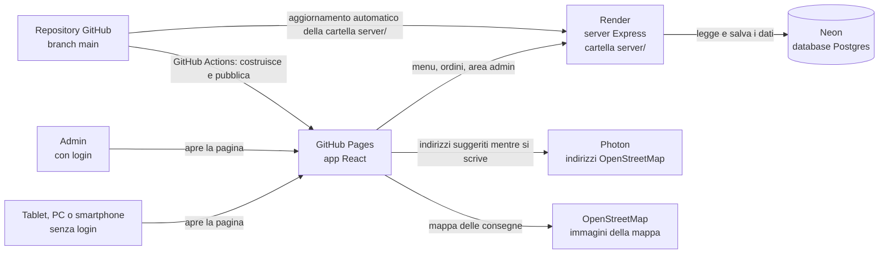
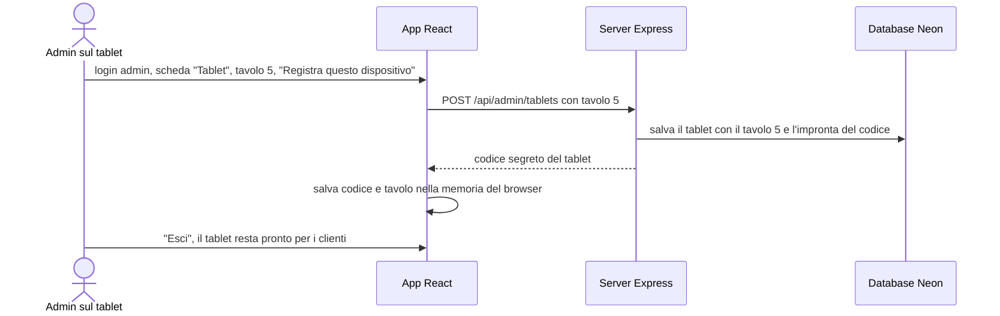
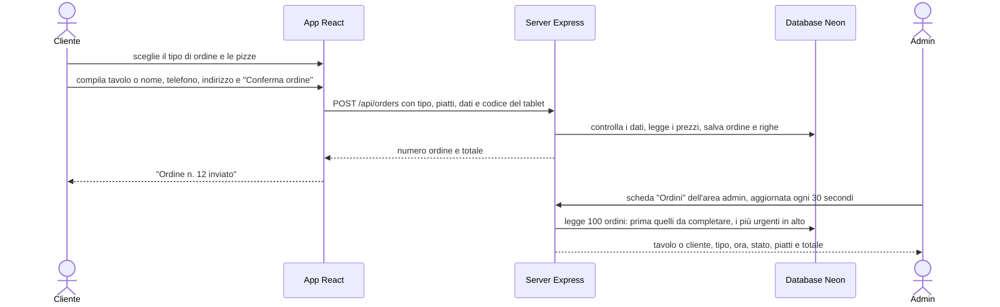
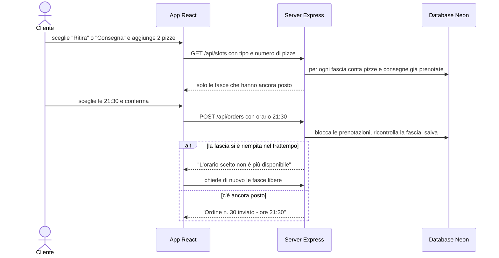
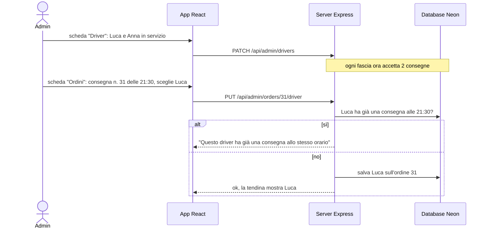
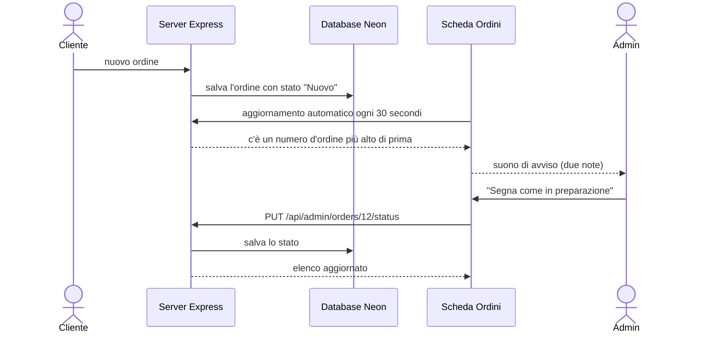
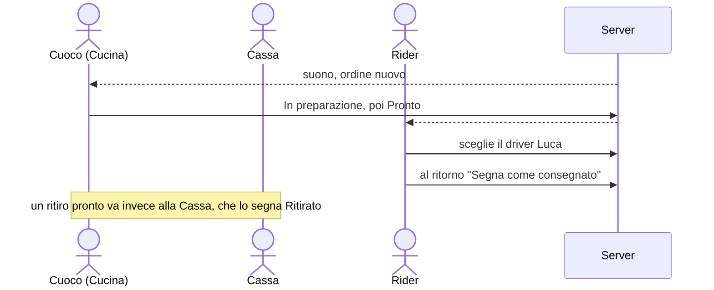
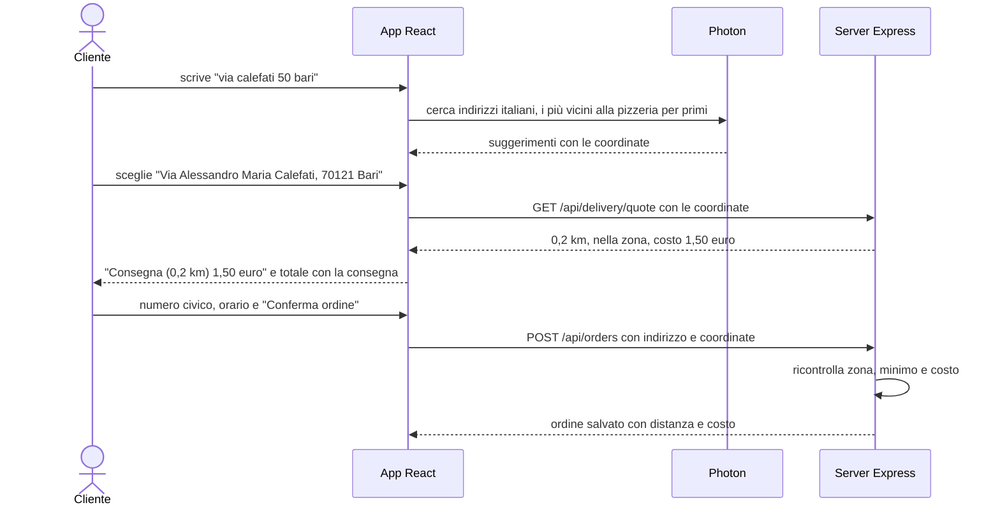
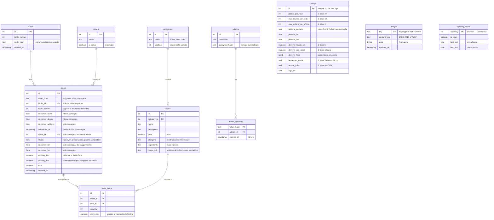
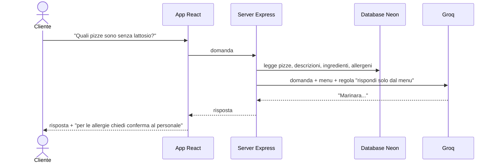

# RestaurantManager: server, database, tavoli e area admin

Data: 22/10/2026, aggiornato il 24/10/2026 · Stato: fasi 1, 3-6 e 8-16 fatte e provate in locale; fasi 2 e 7 (account e messa online) da fare insieme

## Contesto

Prima di questo lavoro RestaurantManager era solo l'interfaccia grafica (React): piatti scritti a mano nel codice e ordini che sparivano chiudendo la pagina.
**Obiettivo**: progetto personale di prova che riproduce un ristorante vero (non destinato alla vendita). Clienti al tavolo **senza account**, un'**area admin con login** che mostra gli ordini e il tavolo da cui arrivano, scelta del tipo di ordine (sul posto, ritiro, consegna), grafica per PC, smartphone e tablet.
**Vincoli**: costo zero; l'app resta su GitHub Pages e si collega a un server e a un database gratuiti.

## Architettura

- **GitHub Pages** ospita solo file statici: l'app si apre subito, i dati arrivano dal server su Render (`.github/workflows/deploy.yml`).
- **Render gratuito** spegne il server dopo 15 minuti senza visite e ci mette circa un minuto a ripartire: in quel minuto l'app mostra "Il server si sta avviando" (`src/Pages/Home/Home.js:31-45`).
- **Neon** (Postgres gratuito, senza scadenza, 1 GB) conserva i dati, perché Render cancella i file del server a ogni spegnimento. Dal 24/10/2026 conserva anche logo e foto delle pizze.
- **Photon** e **OpenStreetMap** (gratuiti, senza account) danno i suggerimenti degli indirizzi e le immagini della mappa: il browser li chiama direttamente, senza passare dal server.
- App e server hanno indirizzi diversi: il server accetta chiamate solo dai siti elencati in `ALLOWED_ORIGINS` (regola **CORS**, `server/index.js:83`) e il login admin usa un **token** inviato a ogni richiesta invece del cookie.
- Il server crea da solo le tabelle mancanti e carica il menu iniziale se il database è vuoto (`server/db.js:32-41`): su Neon non serve lanciare niente a mano.

## Come il tablet conosce il suo tavolo

Con il server online l'indirizzo IP non distingue i tablet (dallo stesso Wi-Fi escono tutti con l'IP del router). Al suo posto ogni tablet viene **registrato una volta** dall'admin, dal tablet stesso.

- Nel database c'è solo l'"impronta" del codice (hash), non il codice (`server/index.js:795-807`).
- Su un dispositivo **non registrato** chi sceglie "Mangia sul posto" scrive il numero del tavolo a mano (`src/Components/Orders/Orders.js`). È la richiesta iniziale ("inserire il numero tavolo, o in automatico"): il piano precedente prevedeva di rifiutare questi ordini, ma così si può provare tutto anche dal PC.
- Se l'admin rimuove un tablet, al suo ordine successivo il server risponde "non più registrato", l'app dimentica il codice e chiede il tavolo a mano (`src/api.js:199-202`).
- Se si cancellano i dati del browser del tablet, va registrato di nuovo.

## Come funziona un ordine e cosa vede l'admin

| Tipo di ordine | Dati richiesti al cliente |
|---|---|
| Mangia sul posto | niente se il tablet è registrato, altrimenti il numero del tavolo |
| Ritira | nome, telefono italiano e orario di ritiro scelto da un elenco |
| Consegna | nome, telefono italiano, indirizzo scelto tra i suggerimenti (più il numero civico se il suggerimento non lo ha) e orario di consegna scelto da un elenco; l'indirizzo deve stare nella zona e l'ordine superare il minimo |

- Il numero del tavolo esiste solo per "Mangia sul posto": per ritiro e consegna il server lo ignora e salva l'orario.

## Orari di ritiro e consegna

| Regola | Valore (24/10/2026) | Chi la cambia |
|---|---|---|
| Fasce orarie | ogni 15 minuti, solo per oggi, ora italiana, tra la prima e l'ultima fascia del giorno della settimana; di base 19:00-23:00 tutti i giorni | admin, scheda "Orari" |
| Giorno di chiusura | nessuna fascia prenotabile | admin, scheda "Orari" |
| Preavviso minimo | la prima fascia proposta è almeno 30 minuti dopo l'ora attuale | codice |
| Cucina | pizze all'ora, di base 24: un quarto per fascia (6) contando ritiri e consegne, e in tutta l'ora contando anche il tavolo | admin, scheda "Orari" > "Cucina e limiti" |
| Driver | tante consegne per fascia quanti sono i driver in servizio | admin, scheda "Driver" |

- Le fasce piene non compaiono: chi ordina 2 pizze vede solo le fasce dove ne restano almeno 2 nel forno; per la consegna solo quelle con meno consegne dei driver in servizio (`server/slots.js:24-57`).
- Con **nessun driver in servizio** la consegna non ha fasce: il cliente legge "Nessun orario disponibile per oggi".
- Due ordini che arrivano nello stesso istante per l'ultimo posto vengono controllati uno alla volta: ne passa uno solo, l'altro riceve "orario non più disponibile" (`server/index.js:267-285`). Provato il 22/10/2026 con due richieste contemporanee.
- Con più pizze di quelle che una fascia accetta (di base 6) nessuna fascia è possibile: l'app scrive di chiamare la pizzeria.
- Gli ordini "Mangia sul posto" non occupano le fasce e non dipendono dagli orari, ma dal 24/10/2026 contano nelle pizze all'ora (vedi "Capacità della cucina e limiti").
- Durata della fascia e preavviso sono costanti in `server/slots.js:5-7`: per cambiarli si modifica quel file. La capienza dal 24/10/2026 la decide l'admin.
- Da 30 minuti prima dell'ultima fascia del giorno non ci sono più fasce per la serata.
- Il totale lo calcola il server con i prezzi del database (`server/index.js:212-263`).

## Sottosezioni dell'area admin

| Scheda | Cosa fa | File |
|---|---|---|
| Ordini | tre sotto-schede, Cucina, Cassa e Rider (vedi "Cucina, Cassa e Rider"); ordini aggiornati ogni 30 secondi, in fila per urgenza, con il pulsante per il passo successivo e un suono di avviso | `src/Pages/Admin/AdminOrders.js` |
| Driver | aggiunge e rimuove driver, li mette o toglie dal servizio, mostra quanti sono in servizio | `src/Pages/Admin/AdminDrivers.js` |
| Consegne | mappa con la pizzeria, la zona e le consegne di oggi colorate per stato; indirizzo della pizzeria, raggio, ordine minimo e fasce di costo | `src/Pages/Admin/AdminDeliveries.js`, `src/Pages/Admin/DeliveryMap.js` |
| Orari | per ogni giorno: aperto o chiuso, prima e ultima fascia; si salva tutta la settimana insieme. Sotto, "Cucina e limiti": pizze all'ora, pizze massime per ordine, ordini al giorno per telefono | `src/Pages/Admin/AdminHours.js`, `src/Pages/Admin/AdminKitchen.js` |
| Tablet | registra questo dispositivo su un tavolo, elenca e rimuove i tablet | `src/Pages/Admin/AdminTablets.js` |
| Ristorante | nome, colore principale, logo e foto di ogni pizza | `src/Pages/Admin/AdminBrand.js` |

- Un driver fa **una consegna per fascia**: nella tendina chi è già impegnato a quell'ora è grigio e non selezionabile, e il server lo rifiuta comunque (`server/index.js:487-524`, `src/Pages/Admin/AdminOrders.js:147-172`, `src/Pages/Admin/AdminOrders.js:307-314`). Dal 24/10/2026 la tendina sta solo nella sotto-scheda Rider.
- Nella tendina compaiono anche i driver non in servizio, con la scritta "(non in servizio)", per poterli usare in caso di imprevisti.
- Gli orari sono controllati dal server: ore valide e ultima fascia non prima della prima (`server/index.js:541-576`).
- Togliere un driver dal servizio non cambia le consegne già prenotate: diminuiscono solo i posti delle fasce ancora libere.

## Stati dell'ordine

Aggiunti il 24/10/2026: la cucina vede a che punto è ogni ordine e lavora per orario, non per ora di arrivo.

| Stato | Colore sulla card | Pulsante sulla card |
|---|---|---|
| Nuovo | corallo pieno | "Segna come in preparazione" |
| In preparazione | giallo | "Segna come pronto" |
| Pronto | verde | "Segna come servito", "ritirato" o "consegnato" |
| Servito (sul posto), Ritirato (ritiro), Consegnato (consegna) | grigio | nessuno: l'ordine è completato |

| Regola | Dettaglio |
|---|---|
| Ordine della lista | prima gli ordini da completare, dal più urgente: orario di ritiro o consegna, oppure ora di arrivo per gli ordini al tavolo; sotto i completati, i più recenti per primi (`server/index.js:462-467`) |
| Cambio di stato | un tocco sul pulsante porta al passo successivo (`src/Pages/Admin/AdminOrders.js:242-250`); non si torna indietro dall'app (scelta del 24/10/2026: più rapido in cucina) |
| Stati validi | solo i 4 dell'elenco, controllati dal server (`server/index.js:36`, `server/index.js:472-485`) e dal database |
| Suono | due note generate dal browser, senza file audio (`src/Pages/Admin/AdminOrders.js:55-71`). Dal pomeriggio del 24/10/2026 dipende dalla sotto-scheda aperta: Cucina per un ordine nuovo, Cassa e Rider per un loro ordine appena diventato pronto (`src/Pages/Admin/AdminOrders.js:120-141`, `src/Pages/Admin/AdminOrders.js:276-280`). Quello che è già stato visto resta ricordato anche cambiando pagina |
| Avviso "suono spento" | se il browser blocca il suono compare una riga che chiede di toccare la pagina; sparisce al primo tocco (`src/Pages/Admin/AdminOrders.js:323-335`, `src/Pages/Admin/AdminOrders.js:370-375`) |

- **Il suono non è immediato**: arriva con l'aggiornamento automatico, quindi fino a 30 secondi dopo l'ordine (subito se si preme "Aggiorna").
- **Il suono richiede un tocco**: i browser suonano solo dopo che la persona ha toccato la pagina. Dopo il login va bene; se si ricarica la pagina restando collegati compare l'avviso "Il browser tiene il suono spento..." finché non si tocca un punto qualsiasi. L'avviso si basa su una funzione che Chrome, Edge e Safari hanno; su un browser che non ce l'ha l'avviso non compare, ma la regola del tocco resta.
- **Solo nella scheda Ordini**: nelle schede Driver, Orari e Tablet e nella pagina del menu il suono non c'è; tornando su Ordini, se nel frattempo sono arrivati ordini nuovi, il suono parte subito (corretto il 24/10/2026: prima restava muto).
- **Scheda del browser in secondo piano**: Chrome rallenta gli aggiornamenti delle schede nascoste da alcuni minuti, quindi il suono può arrivare fino a circa un minuto dopo.
- **Errori di stato**: se si tocca il pulsante per sbaglio non c'è "indietro"; per correggere serve l'editor SQL di Neon (`UPDATE orders SET status = 'nuovo' WHERE id = 12`).
- **Ordini vecchi non completati** restano in cima alla lista finché qualcuno non li completa, perché sono i "più urgenti".
- **Fasce orarie**: un ordine completato continua a contare nei posti della sua fascia (forno e driver), perché quella fascia l'ha comunque occupata.
- Se ci fossero più di 100 ordini da completare, i completati non comparirebbero: per una pizzeria in una sera non succede.
- Lo stato si cambia anche da due dispositivi admin insieme: vince l'ultimo tocco, e l'altro dispositivo lo vede al suo aggiornamento successivo.

| File | Tipo | Complessità | Cosa cambia |
|---|---|---|---|
| `server/db/schema.sql` | modifica (3 righe) | bassa | colonna `status` sugli ordini (`server/db/schema.sql:62-64`) |
| `server/index.js` | modifica | media | stato nell'elenco ordini, nuovo ordine della lista, nuovo servizio per cambiare lo stato |
| `src/api.js` | modifica | bassa | chiamata `setOrderStatus` (`src/api.js:226-231`) |
| `src/Pages/Admin/AdminOrders.js` | modifica | media | stato sulla card, pulsante, suono, avviso "suono spento", frase in alto |
| `src/Pages/Admin/Admin.css` | modifica | bassa | colori degli stati e pulsante a tutta larghezza (`src/Pages/Admin/Admin.css:184-211`) |

Riusa `Button` per il pulsante e lo stile `admin-badge` per lo stato. Tocca le API (un servizio nuovo, uno con un campo in più) e lo schema del database; non tocca variabili d'ambiente, deploy o test.

Prove del 24/10/2026 con un database di prova: ordini dei tre tipi, ogni passo di stato fino a Servito, Ritirato e Consegnato, lista nell'ordine giusto, stato inesistente, ordine inesistente e richiesta senza login rifiutati; suono solo per un ordine nuovo (non al primo caricamento, non con "Aggiorna" senza novità, non dopo un cambio di stato); con le regole normali di Chrome sui suoni: suona dopo il login, suona tornando dalla pagina del menu se nel frattempo è arrivato un ordine, dopo un ricaricamento resta spento e mostra l'avviso, dopo un tocco suona di nuovo; confermato anche dalla prova dell'utente; database senza la colonna che la riceve al riavvio del server con gli ordini in stato "Nuovo"; schermate su PC e smartphone, nessun errore in console.

## Cucina, Cassa e Rider (24/10/2026, pomeriggio)

La scheda "Ordini" è divisa in tre sotto-schede, una per chi lavora sugli ordini. Cassa e Rider vedono solo ordini che il cuoco ha già segnato come pronti.

| Sotto-scheda | Chi la usa | Ordini che vede | Cosa può fare | Suono |
|---|---|---|---|---|
| Cucina | cuoco | tutti gli ordini Nuovi e In preparazione (tavolo, ritiro, consegna) e quelli al tavolo già Pronti | Nuovo → In preparazione → Pronto; per i tavoli anche Pronto → Servito | quando arriva un ordine nuovo |
| Cassa | cassa | ritiri Pronti | Pronto → Ritirato | quando un ritiro diventa pronto |
| Rider | ragazzo delle consegne | consegne Pronte | sceglie il driver dalla tendina; Pronto → Consegnato | quando una consegna diventa pronta |

- Le regole di ogni sotto-scheda sono in `src/Pages/Admin/AdminOrders.js:82-118`; la card dell'ordine è la stessa per tutte e tre (`src/Pages/Admin/AdminOrders.js:175-253`).
- Sotto gli ordini da lavorare c'è "Completati oggi", in grigio: per la Cucina i tavoli serviti, per la Cassa i ritiri, per il Rider le consegne.
- Accanto al nome di ogni sotto-scheda c'è il numero di ordini da lavorare, per esempio "Cassa (1)".
- Ogni dispositivo ricorda l'ultima sotto-scheda aperta (`src/api.js:37-41`): il tablet della cucina si riapre su Cucina, il telefono del rider su Rider.
- Il suono parte solo nella sotto-scheda aperta: se la Cassa è aperta, una consegna pronta non suona.
- Fuori dalla sotto-scheda Rider la consegna mostra il driver solo come testo ("Driver: Luca" o "Nessun driver assegnato").
- Il pulsante "Segna come..." sta sempre in fondo alla card: card vicine di lunghezza diversa hanno i pulsanti alla stessa altezza (`src/Pages/Admin/Admin.css`, classi `admin-order-card` e `admin-order-body`).
- Le barre di scorrimento di tutto il sito sono sottili e grigie, in tinta con lo sfondo scuro (`src/index.css`).
- Tutti entrano con lo stesso login admin: non ci sono ancora account separati per cuoco, cassa e rider, quindi ognuno può aprire anche le altre schede.
- Provato il 24/10/2026 nel browser: ordine nuovo con suono in Cucina, ritiro portato a Pronto che passa alla Cassa, consegna pronta che non suona in Cassa, ritiro pronto che suona in Cassa, driver scelto e consegna segnata nel Rider, sotto-scheda ricordata dopo il ricaricamento, schermate su PC e telefono, nessun errore in console.

## Consegna, limiti, ringraziamento e aspetto del locale (24/10/2026)

Sei punti fatti insieme il 24/10/2026: i "Prossimi passi" da 8 a 15 (le foto sì, la gestione completa del menu del punto 5 no), più la capienza della cucina del punto 7.

### Consegna: zona, costo e ordine minimo

| Regola | Valore di partenza | Chi la cambia |
|---|---|---|
| Consegne attive | solo dopo che l'admin ha salvato l'indirizzo della pizzeria; prima il cliente legge "Le consegne non sono ancora disponibili" | admin, scheda "Consegne" |
| Zona servita | cerchio di 5 km dalla pizzeria, in linea d'aria (non lungo le strade) | admin, scheda "Consegne" |
| Costo di consegna | a fasce di distanza: fino a 3 km 2 euro, fino a 5 km 3 euro; oltre l'ultima fascia, fino al raggio, vale l'ultima | admin, da 1 a 6 fasce |
| Ordine minimo | 10 euro di pizze, senza il costo di consegna | admin |
| Indirizzo | scelto tra i suggerimenti mentre si scrive; se il suggerimento non ha il numero civico compare un campo "Numero civico" | codice |

- Il server ricalcola sempre distanza, zona, costo e minimo (`server/index.js:244-262`, `server/delivery.js:42-51`): quello che mostra l'app è solo un'anteprima.
- I suggerimenti arrivano da **Photon**, servizio gratuito basato su OpenStreetMap, chiamato direttamente dal browser (`src/api.js:127-171`). Partono dopo 4 lettere e una pausa di 0,4 secondi, per non caricare il servizio (`src/Components/AddressField/AddressField.js:7-8`).
- Il campo indirizzo è un componente nuovo riusabile, `AddressField`: lo usano il carrello e l'indirizzo della pizzeria nell'admin.
- **Scheda admin "Consegne"**: mappa OpenStreetMap con la pizzeria, il cerchio della zona e un punto per ogni consegna di oggi, colorato come lo stato dell'ordine; toccando il punto si vedono numero, cliente, orario, stato, indirizzo, telefono, driver e totale. Si aggiorna da sola ogni 30 secondi. Sotto ci sono le impostazioni (indirizzo della pizzeria, raggio, minimo, fasce).
- Le consegne arrivate prima del 24/10/2026 non hanno coordinate: la scheda le conta come "senza posizione".
- Sulla card dell'ordine compare la riga "Consegna (0,2 km)" con il costo; il totale lo comprende.
- Nomi e indirizzi nei fumetti della mappa sono inseriti come testo semplice, perché li scrivono i clienti (`src/Pages/Admin/DeliveryMap.js:21-34`).

### Telefono controllato mentre si scrive

- Valgono solo numeri italiani: cellulari che iniziano con 3 (9 o 10 cifre) e fissi che iniziano con 0, con o senza +39; spazi, punti e trattini si possono scrivere. Stessa regola nell'app e nel server (`src/api.js:182`, `server/index.js:65-71`).
- Il messaggio rosso compare uscendo dal campo o premendo "Conferma ordine", che non parte finché il numero non è valido.
- Il server salva il numero solo con le cifre (per esempio `3331234567`), così lo stesso numero scritto in modi diversi conta come uno solo nei limiti.
- Il campo di testo comune `TextField` ha un'opzione nuova, `error`: mostra il messaggio sotto il campo e il bordo rosso.

### Schermata "Grazie" dopo l'ordine

- Dopo l'invio compare a tutto schermo "Grazie per l'ordine!" con numero, tipo, tavolo o nome, orario e totale, e fuochi d'artificio di spicchi di pizza, pomodori, fette di salame e mozzarelle disegnati in CSS (componente `src/Components/ThankYou/`).
- Dopo 6 secondi, o toccando "Nuovo ordine", torna al menu; una barra mostra il tempo che resta (`src/Components/ThankYou/ThankYou.js:6`).
- Tavolo, nome, telefono, indirizzo, numero civico e orario si svuotano subito dopo l'invio (`src/Components/Orders/Orders.js:85-99`): sul tablet il cliente successivo trova tutto pulito. Il tipo di ordine scelto nella tendina resta.
- Chi ha attivato "riduci animazioni" nel telefono o nel computer vede la schermata senza fuochi d'artificio.

### Capacità della cucina e limiti

| Limite | Valore di partenza | Vale per | Messaggio al cliente |
|---|---|---|---|
| Pizze all'ora | 24 | ogni fascia di 15 minuti accetta un quarto (6) di pizze da ritirare o consegnare; ogni ora intera (per esempio 20:00-21:00) accetta 24 pizze contando anche quelle ordinate al tavolo in quell'ora | le fasce piene non compaiono |
| Pizze massime per ordine | 10 | solo ritiro e consegna: un tavolo grande può sempre ordinare | "Puoi ordinare al massimo 10 pizze: per ordini più grandi chiama la pizzeria" |
| Ordini al giorno per telefono | 3 | ritiro e consegna con lo stesso numero nella stessa giornata (ora italiana) | "Con questo numero sono già stati fatti troppi ordini oggi: per altri ordini chiama la pizzeria" |
| Password admin sbagliate | 5 | dalla stessa rete: dopo la quinta il login si blocca per 15 minuti | "Troppe password sbagliate: riprova tra 15 minuti" |

- I primi tre si cambiano nella scheda "Orari", sezione "Cucina e limiti" (`src/Pages/Admin/AdminKitchen.js`); il blocco del login è fisso nel codice (`server/auth.js:13-54`).
- Gli ordini al tavolo **contano ma non si bloccano**: se in un'ora il tavolo ha già usato molte pizze, ritiro e consegna vedono meno fasce libere, ma chi è seduto può sempre ordinare (scelta del 24/10/2026). Il conto per ora è in `server/slots.js:24-57`.
- Esempio: 24 pizze all'ora e 10 pizze ordinate al tavolo alle 20:10. Nell'ora 20:00-21:00 restano 14 pizze: chi vuole ritirare 2 pizze trova ancora le fasce delle 20, fino a 6 per fascia. Provato il 24/10/2026 con 12 pizze all'ora.
- Il blocco del login ricorda i tentativi nella memoria del server: un riavvio lo azzera. ⚠️ Online il server deve sapere quanti "intermediari" (proxy) ci sono tra il visitatore e lui, altrimenti tutti i visitatori sembrano la stessa rete e cinque errori di chiunque bloccano tutti. Il numero va in `TRUST_PROXY_HOPS` su Render (`server/index.js:82`): nei forum di Render si parla di 3, da verificare dopo la messa online.
- Non c'è un limite per indirizzo di rete sugli ordini al tavolo: i tablet del locale escono tutti dallo stesso indirizzo e verrebbero bloccati insieme.

### Aspetto del locale (white label) e foto delle pizze

- **Scheda admin "Ristorante"** (`src/Pages/Admin/AdminBrand.js`): nome del locale, colore principale scelto tra 8 tinte leggibili con il testo bianco, logo, e una foto per ogni pizza (carica, cambia, togli).
- Il colore corallo prima era scritto a mano 39 volte in 12 file; ora è una variabile di colore unica in `src/index.css`, che l'app sostituisce con quella scelta (`src/brand.js:14-27`). Lo stesso vale per titolo e icona della scheda del browser: il logo diventa l'icona.
- Nome, colore e logo vengono ricordati dal browser, così alla visita successiva la pagina parte già con quelli giusti.
- Il nome nel menu si vede esattamente come lo scrive l'admin (prima ogni parola prendeva la maiuscola).
- **Foto**: rotonde al posto della pizza disegnata; toccandole si apre "Maggiori info" con la foto grande (il popup `Modal` ha un'opzione nuova, `image`). Senza foto resta la pizza disegnata.
- Le immagini vengono rimpicciolite nel browser prima dell'invio (foto 800 pixel, logo 256 pixel) e salvate nel database Neon: nessun servizio o account in più. Il server accetta solo JPEG, PNG e WebP, controllati dai primi byte del file, al massimo 1 MB (`server/images.js:5-14`). Ogni foto ha un indirizzo che cambia quando la si sostituisce, così i browser la tengono in memoria senza riscaricarla.
- **Foto di partenza**: 8 foto gratuite di Pexels (licenza libera, citazione non obbligatoria), in `server/db/photos/`, circa 1 MB in tutto. Un database nuovo le carica da solo al primo avvio (`server/db.js:32-41`); per un database creato prima si lancia `npm run load-photos` nella cartella `server/`. Sono foto generiche di pizze: per esempio "Prosciutto e Funghi" mostra solo i funghi e "Marinara" ha un po' di formaggio. L'admin le può sostituire.
- **Icona e nome di partenza**: al posto del logo di React ora c'è uno spicchio di pizza (`public/favicon.svg`, `public/logo192.png`, `public/logo512.png`), il titolo della scheda è "Restaurant Manager" e l'app installata sul telefono si chiama "Ristorante". Il file `public/favicon.ico` (logo di React) è stato tolto.

### Piccole cose

- Il test automatico (`src/App.test.js`) cercava la scritta "learn react" del progetto di partenza e falliva: ora simula il server e controlla che l'app mostri nome e colore del locale e il menu ricevuto. Passa.
- Tolti i due avvisi di variabili non usate in `src/Components/Modal/Modal.js` e `src/Components/Sidebar/Sidebar.js`: il controllo del codice non segnala più niente.

### File toccati

| File | Tipo | Complessità | Cosa cambia |
|---|---|---|---|
| `server/db/schema.sql` | modifica | media | tabella `settings` (una riga di impostazioni), tabella `images`, colonne della consegna sugli ordini |
| `server/index.js` | modifica | alta | telefono italiano, limiti, consegna, blocco login, servizi per consegna, cucina, aspetto e immagini |
| `server/slots.js` | modifica | media | capienza da impostazioni e limite per ora |
| `server/delivery.js`, `server/images.js`, `server/scripts/load-photos.js` | nuovi | media | distanza e costo; controllo e salvataggio immagini; caricamento foto di partenza |
| `server/auth.js` | modifica | bassa | blocco dopo 5 password sbagliate |
| `server/db.js`, `server/package.json`, `server/.env.example` | modifica | bassa | foto al primo avvio, comando `load-photos`, variabile `TRUST_PROXY_HOPS` |
| `server/db/photos/` | nuovi | bassa | 8 foto di partenza |
| `src/api.js` | modifica | media | consegna, suggerimenti Photon, telefono, aspetto, invio immagini |
| `src/brand.js` | nuovo | media | nome, colore e logo per tutta l'app |
| `src/Components/AddressField/`, `src/Components/ThankYou/` | nuovi | media | campo indirizzo con suggerimenti; schermata "Grazie" |
| `src/Components/Orders/Orders.js` e `.css` | modifica | alta | telefono, indirizzo, costo, minimo, campi svuotati; tolto il vecchio riepilogo laterale dopo l'invio |
| `src/Components/TextField/`, `src/Components/Modal/`, `src/Components/Card/` | modifica | bassa | opzione `error`; opzione `image`; foto rotonda cliccabile |
| `src/Pages/Admin/AdminDeliveries.js`, `DeliveryMap.js`, `AdminKitchen.js`, `AdminBrand.js`, `resizeImage.js` | nuovi | alta | schede Consegne e Ristorante, sezione Cucina e limiti |
| `src/Pages/Admin/Admin.js`, `AdminHours.js`, `AdminOrders.js`, `Admin.css` | modifica | bassa | schede nuove, costo di consegna sulla card, stili |
| `src/Pages/Home/Home.js` e `.css`, `src/App.js`, `src/index.css` | modifica | bassa | nome e logo dal server, variabili di colore |
| 11 file `.css` e `Sidebar.js` | modifica | bassa | corallo sostituito dalle variabili di colore |
| `public/index.html`, `public/manifest.json`, icone | modifica | bassa | titolo, nome e icona di partenza |
| `package.json` | modifica (1 riga) | bassa | libreria **Leaflet 1.9.4** per la mappa (nuova dipendenza, approvata il 24/10/2026) |

| Tocca | Sì/No | Dettaglio |
|---|---|---|
| API o contratti tra servizi | sì | servizi nuovi (vedi tabella API); `POST /api/orders` per la consegna vuole anche `customerLat` e `customerLon`; `GET /api/admin/orders` ha 4 campi in più |
| Schema del database | sì | 2 tabelle nuove e 4 colonne nuove sugli ordini, aggiunte da sole all'avvio anche su un database esistente |
| Configurazioni di deploy e variabili d'ambiente | sì | `TRUST_PROXY_HOPS` su Render (facoltativa, vedi sopra) |
| Test esistenti | sì | l'unico test è stato riscritto e ora passa |

Prove del 24/10/2026 con un database di prova, su PC e smartphone: telefoni validi e non validi; schermata "Grazie" e campi vuoti; pizze all'ora con ordini al tavolo simulati; limite di pizze per ordine e di ordini per telefono; blocco dopo 5 password sbagliate; consegna dentro e fuori zona, sotto il minimo, senza coordinate e prima di configurare la pizzeria; suggerimenti reali di Photon con numero civico mancante; mappa con fumetti; cambio di nome, colore, logo e foto con aggiornamento immediato del sito; un file SVG travestito da PNG e un file troppo grande rifiutati. Nessun errore in console; test automatico e controllo del codice puliti.

## Componenti riusabili

Regola dal 22/10/2026: se una schermata ha bisogno di un elemento che esiste già si usa lo stesso componente; se gli manca qualcosa gli si aggiunge un'opzione facoltativa, senza cambiare chi lo usa già.

| Componente | Cosa fa | Opzioni | Dove si usa |
|---|---|---|---|
| `Button` (`src/Components/Button/Button.js`) | pulsante | `variant`: "primary" (corallo) o "secondary" (scuro con bordo grigio); `className` per spazi e dimensioni decisi dalla pagina | carrello ("Conferma ordine", "Nuovo ordine", "Torna al menu"), "Riprova" del menu, tutte le schede admin |
| `TextField` (`src/Components/TextField/TextField.js`) | campo per testo, numero, telefono, password, orario | le stesse di un campo normale (`type`, `placeholder`, `value`...); con `type="password"` compare da solo un occhio che mostra o nasconde la password (dal 24/10/2026); `error`: messaggio rosso sotto il campo (dal 24/10/2026) | carrello (tavolo, nome, telefono, indirizzo), login admin, Driver, Orari, Tablet |
| `DropdownField` (`src/Components/DropdownField/DropdownField.js:6-13`) | tendina | `selectedIndex`: voce mostrata decisa da fuori; `disabledIndexes`: voci grigie non selezionabili; la larghezza la decide la pagina che la usa | tipo di ordine nel menu, driver sulle consegne |
| `ListRow` (`src/Components/ListRow/ListRow.js`) | riga di un elenco: titolo e nota a sinistra, pulsanti o campi a destra | `title`, `note`, contenuto a destra | schede Driver, Orari, Tablet |
| `useAdminError` (`src/Pages/Admin/useAdminError.js`) | messaggio d'errore delle schede admin; con la sessione scaduta torna al login | | schede Ordini, Driver, Orari, Tablet |
| `AddressField` (`src/Components/AddressField/AddressField.js`), dal 24/10/2026 | campo indirizzo con i suggerimenti di Photon; l'indirizzo vale solo se scelto dall'elenco | `value`, `onChange`, `onSelect` (indirizzo scelto con le coordinate), `center` (indirizzi vicini per primi), `placeholder`, `error` | carrello (consegna), scheda Consegne (pizzeria) |
| `Modal` (`src/Components/Modal/Modal.js`) | finestra "Maggiori info" del piatto | `image` dal 24/10/2026: foto grande in alto | card del menu |

- Restano con uno stile proprio perché non sono pulsanti normali: la barra "Vedi ordine" su smartphone, i pulsanti +/- delle quantità, le fasce orarie del carrello, "Aggiungi" della card (fa parte della card cliccabile) e il campo di ricerca (ha l'icona e un suo stile).
- Cambi visibili: il testo dei campi del carrello passa da 14 a 15 px e il pulsante "Riprova" prende lo stile comune (un po' più stretto, con l'ombra). Il resto è uguale: confrontate le schermate prima e dopo su PC e smartphone.
- Prove del 22/10/2026 su PC e smartphone: ordine di ritiro completo, ordine al tavolo con e senza numero, "Torna al menu", login errato e giusto, driver assegnato e tolto dalla tendina, driver aggiunto, tolto dal servizio e rimosso, giorno chiuso e riaperto, tablet registrato e annullato, sessione scaduta che riporta al login. Nessun avviso in console.
- **Occhio sul campo password** (24/10/2026): ogni campo password ha a destra un occhio; toccandolo la password diventa leggibile e l'icona diventa un occhio sbarrato, toccandolo di nuovo torna nascosta (`src/Components/TextField/TextField.js:9-40`, stile in `src/Components/TextField/TextField.css:21-56`). Le due icone sono disegnate in SVG (`src/Components/Assets/EyeIcon.js`, `src/Components/Assets/EyeOffIcon.js`) perché il font di icone del progetto non ha l'occhio. Su Edge l'occhio del browser viene nascosto, così non ne compaiono due. Oggi l'unico campo password è quello del login admin. Provato il 24/10/2026 su smartphone: mostra, nasconde, la password scritta resta uguale.

## Dati salvati

- Tabelle in `server/db/schema.sql`, menu iniziale (8 pizze con prezzi indicativi) in `server/db/seed.sql`. I 7 giorni di `opening_hours` vengono creati all'avvio del server con l'orario 19:00-23:00 (`server/db/schema.sql:36-38`).
- Se si rimuove un driver, le sue consegne passate restano senza driver.
- `ingredients` è pronto per quando aggiungerai gli ingredienti; l'app per ora non lo mostra. `image_url` dal 24/10/2026 punta alla foto salvata nella tabella `images`.
- Per cambiare pizze e prezzi oggi si modifica il database (per esempio dall'editor SQL di Neon): la gestione del menu dall'area admin è fuori da questo lavoro.

## Servizi del server (API)

| Indirizzo | Cosa fa | Chi può usarlo |
|---|---|---|
| `GET /api/health` | risponde "ok" e sveglia il database | tutti |
| `GET /api/menu` | categorie con almeno un piatto, ognuna con i suoi piatti | tutti |
| `GET /api/slots?type=ritiro&dishes=2` | fasce orarie ancora libere per quel tipo e quel numero di pizze | tutti |
| `POST /api/orders` | salva un ordine e restituisce numero, costo di consegna e totale | tutti |
| `GET /api/delivery` | se le consegne sono attive, zona, ordine minimo e fasce di costo | tutti |
| `GET /api/delivery/quote?lat=...&lon=...` | distanza, se è nella zona e costo per un indirizzo | tutti |
| `GET /api/settings` | nome, colore e logo del locale | tutti |
| `GET /api/images/:key` | logo o foto di un piatto | tutti |
| `POST /api/admin/login` e `/logout` | entrata e uscita admin | admin |
| `GET /api/admin/orders` | 100 ordini, prima quelli da completare, con tavolo o cliente, tipo, ora, stato, driver, piatti, totale | admin |
| `PUT /api/admin/orders/:id/status` | cambia lo stato di un ordine | admin |
| `PUT /api/admin/orders/:id/driver` | assegna o toglie il driver di una consegna | admin |
| `GET` / `PUT /api/admin/opening-hours` | legge e salva gli orari dei 7 giorni | admin |
| `GET` / `POST` / `PATCH` / `DELETE /api/admin/drivers` | elenca, aggiunge, mette in servizio o toglie, rimuove driver | admin |
| `GET` / `POST` / `DELETE /api/admin/tablets` | elenca, registra e rimuove tablet | admin |
| `GET` / `PUT /api/admin/delivery` | legge e salva pizzeria, raggio, minimo e fasce di costo | admin |
| `GET` / `PUT /api/admin/kitchen` | legge e salva pizze all'ora, pizze per ordine, ordini per telefono | admin |
| `PUT /api/admin/brand` | salva nome e colore | admin |
| `PUT` / `DELETE /api/admin/images/:key` | carica (il corpo è l'immagine) o toglie il logo o la foto di un piatto | admin |

Rispetto al piano iniziale `GET /api/categories` e `GET /api/dishes` sono diventati un solo `GET /api/menu`: una sola chiamata, utile quando il server si sta svegliando.

## Fasi di lavoro

| Fase | Cosa si fa | Stato |
|---|---|---|
| 1. Grafica PC | 8 pizze, card con pizza disegnata in CSS, carrello con quantità e totale, tipo di ordine, bug "Maggiori info" corretto | fatta |
| 2. Account | account gratuiti su Neon e Render | **da fare (tu)** |
| 3. Database e server | server Express, tabelle, menu dal database | fatta, provata con un database Postgres locale |
| 4. Tablet e tavoli | registrazione tablet, tavolo automatico o scritto a mano | fatta |
| 5. Area admin | login, ordini, tablet, script per creare l'admin | fatta |
| 6. Responsive | smartphone: menu in basso, carrello a tutto schermo con barra "Vedi ordine"; tablet verticale e orizzontale | fatta |
| 7. Online | server su Render, app su GitHub Pages | **da fare insieme**: file pronti, servono gli account |
| 8. Sottosezioni admin | schede Driver e Orari, driver sulle consegne, fasce calcolate da orari e driver in servizio | fatta |
| 9. Componenti riusabili | pulsante, campo di testo, tendina e riga comuni a menu cliente e admin | fatta |
| 10. Stati dell'ordine | stato con pulsante sulla card, lista per urgenza, suono per gli ordini nuovi | fatta il 24/10/2026, vedi "Stati dell'ordine" |
| 11. Consegna | indirizzi suggeriti, zona, costo a fasce, ordine minimo, scheda Consegne con mappa | fatta il 24/10/2026 |
| 12. Telefono e ringraziamento | numero italiano controllato nel campo, schermata "Grazie" e campi vuoti | fatta il 24/10/2026 |
| 13. Cucina e limiti | pizze all'ora, pizze per ordine, ordini per telefono, blocco del login | fatta il 24/10/2026 |
| 14. Aspetto del locale | nome, colore, logo e foto delle pizze dall'admin; icona e titolo di partenza | fatta il 24/10/2026 |
| 15. Piccole cose | test automatico riscritto, avvisi tolti | fatta il 24/10/2026 |
| 16. Cucina, Cassa e Rider | ordini divisi per chi ci lavora, suono per sotto-scheda | fatta il 24/10/2026 |

Prove fatte il 22/10/2026 su PC (1440x900), smartphone (390x844), tablet verticale (820x1180) e orizzontale (1180x820): ordine al tavolo scritto a mano, consegna, errore senza tavolo, login sbagliato e giusto, registrazione tablet, ordine con tavolo automatico, ordine visto dall'admin. Le API sono state provate anche con dati sbagliati (tavolo mancante, telefono non valido, piatto inesistente, codice tablet falso, CORS da un sito non autorizzato).

Prove della fase 8 (22/10/2026): nessun driver in servizio = nessuna fascia di consegna; con 2 driver la terza consegna nella stessa fascia viene rifiutata; stesso driver su due consegne alla stessa ora rifiutato; driver inesistente, giorno chiuso, ora non valida e ultima fascia prima della prima rifiutati; schede Driver, Orari e Ordini provate dal browser su PC, smartphone e tablet.

## Come provarlo sul PC

| Passo | Comando o azione |
|---|---|
| 1 | in `server/` copiare `.env.example` in `.env` e mettere in `DATABASE_URL` l'indirizzo del database Neon |
| 2 | in `server/`: `npm install`, poi `npm run create-admin -- <nome> <password>` (password di almeno 8 caratteri) |
| 3 | in `server/`: `npm run dev` (server su `http://localhost:4000`) |
| 4 | nella cartella principale: `npm start` (app su `http://localhost:3000`, legge l'indirizzo del server da `.env.development`) |
| 5 | solo per un database creato prima del 24/10/2026: in `server/` `npm run load-photos` per le foto di partenza |
| 6 | area admin > Consegne: scegliere l'indirizzo della pizzeria e salvare, altrimenti le consegne restano ferme |

## Come metterlo online

| Passo | Dove | Cosa fare |
|---|---|---|
| 1 | neon.com | creare il progetto e copiare la "connection string" |
| 2 | PC | creare l'admin sul database Neon con il passo 2 della tabella sopra |
| 3 | render.com | New > Web Service > repository RestaurantManager; Root Directory `server`; Build Command `npm ci`; Start Command `npm start`; piano Free |
| 4 | Render > Environment | `DATABASE_URL` = connection string di Neon; `ALLOWED_ORIGINS` = `https://josecontis.github.io`; `TRUST_PROXY_HOPS` = numero di intermediari davanti al server (⚠️ da verificare, i forum di Render dicono 3) |
| 5 | GitHub > Settings > Pages | Source: "GitHub Actions" |
| 6 | GitHub > Settings > Secrets and variables > Actions > Variables | `API_URL` = indirizzo del servizio Render (senza `/` finale) |
| 7 | PC | `git push` su main: GitHub Actions pubblica l'app su `https://josecontis.github.io/RestaurantManager/` |
| 8 | area admin online | scheda Consegne: indirizzo della pizzeria; scheda Ristorante: nome, colore e logo se diversi da quelli di partenza |

La versione di Node su Render è fissata a 22 dal campo `engines` di `server/package.json`.

## Tabella impatti

| File | Tipo | Cosa cambia |
|---|---|---|
| `src/Components/Tab/Tab.js` | modifica | schede e piatti arrivano dal server; tipi di ordine presi da `src/api.js`; filtro della ricerca su categoria, nome, descrizione e ingredienti, senza distinguere maiuscole e accenti |
| `src/Components/SearchField/SearchField.js` | modifica | il campo di ricerca comunica il testo scritto (prima non era collegato a niente) |
| `src/Components/Card/Card.js` | modifica | pulsante "Aggiungi", prezzo in euro, "Maggiori info" non aggiunge più il piatto |
| `src/Components/DropdownField/DropdownField.js` | modifica | comunica l'opzione scelta; riusabile: chi la usa può decidere la voce mostrata e le voci non selezionabili. È la stessa tendina nel menu cliente e per il driver nell'admin. Tolto un campo nascosto che si ripeteva uguale in ogni tendina, aggiunta la `key` che React chiedeva |
| `src/Components/Orders/Orders.js` | modifica | carrello, campi per tavolo o cliente, invio, conferma, barra "Vedi ordine" su smartphone |
| `src/Pages/Home/Home.js` | modifica | carica il menu, gestisce carrello, tipo di ordine e invio |
| `src/Pages/Admin/` (7 file `.js` + `Admin.css`) | nuovi | area admin: login, ordini con scelta del driver, driver, orari, tablet, gestione errori comune |
| `src/Components/Button/`, `src/Components/TextField/`, `src/Components/ListRow/` (`.js` + `.css`) | nuovi | componenti comuni a menu cliente e admin |
| `src/api.js` | nuovo | tutte le chiamate al server e la memoria del browser (tablet e admin) |
| `src/App.js` | modifica | `HashRouter`, `/` apre il menu, rotta `/Admin` |
| `src/Components/Sidebar/Sidebar.js` | modifica | la voce "Settings" diventa "Admin"; l'icona attiva segue l'indirizzo |
| file `.css` di Card, Tab, Orders, Home, Sidebar, SearchField, DropdownField, Modal | modifica | grafica nuova e regole per smartphone e tablet; il popup "Maggiori info" resta visibile anche scorrendo; la tendina aperta ha bordo grigio e angoli arrotondati e resta sopra le card; la larghezza della tendina del menu ora è decisa in `src/Components/Tab/Tab.css` |
| `package.json` | modifica (1 riga) | `"homepage": "."`, necessario per GitHub Pages |
| `.env.development` | nuovo | indirizzo del server sul PC |
| `.github/workflows/deploy.yml` | nuovo | pubblicazione su GitHub Pages a ogni push su main |
| `.gitignore` | modifica (3 righe aggiunte) | esclude `server/node_modules` e `server/.env` |
| `server/` (`index.js`, `db.js`, `auth.js`, `slots.js`, `db/schema.sql`, `db/seed.sql`, `scripts/create-admin.js`, `package.json`, `.env.example`) | nuovi | server, database, login admin, tablet, fasce orarie, orari di apertura, driver |

| Tocca | Sì/No | Dettaglio |
|---|---|---|
| API o contratti tra servizi | sì | i servizi della tabella API |
| Schema del database | sì | database nuovo, 9 tabelle |
| Configurazioni di deploy e variabili d'ambiente | sì | `DATABASE_URL`, `ALLOWED_ORIGINS` su Render; `API_URL` su GitHub; `homepage`; workflow GitHub Actions |
| Test esistenti | no | l'unico test (`src/App.test.js:4-8`) cerca "learn react" e **fallisce già da prima** di questo lavoro. Non l'ho toccato (riscritto il 24/10/2026, vedi "Piccole cose") |

## Note e rischi

- **Prima visita lenta**: dopo 15 minuti senza visite il server su Render impiega circa un minuto a ripartire.
- **Password**: `DATABASE_URL` solo su Render e in `server/.env` (escluso da git). La password admin passata a `npm run create-admin` resta nella cronologia del terminale: per una prova va bene.
- **Server pubblico**: chiunque conosca l'indirizzo può inviare ordini "sul posto" scrivendo un tavolo qualsiasi. Per una prova è accettabile. Dal 24/10/2026 il login admin si blocca dopo 5 password sbagliate e ritiro e consegna hanno limiti per telefono e per ordine.
- **Coordinate della consegna**: il server controlla solo che siano in Italia. Chi manda richieste a mano, senza l'app, potrebbe scrivere coordinate vicine alla pizzeria con un indirizzo lontano; l'admin se ne accorge dalla mappa.
- **Photon e OpenStreetMap**: gratuiti e senza account, ma senza garanzia: se Photon non risponde il cliente legge "Suggerimenti non disponibili" e non può scegliere l'indirizzo. L'indirizzo che il cliente scrive viene inviato a Photon (servizio di komoot, Germania) per avere i suggerimenti. Se un giorno servisse più affidabilità, l'alternativa valutata è Geoapify (gratis fino a 3.000 richieste al giorno, con account). Google è stato scartato: chiede un account di fatturazione con carta.
- **Dati OpenStreetMap incompleti**: in Italia molti civici non ci sono; per questo il campo "Numero civico" compare quando il suggerimento non lo ha. Anche la qualità della ricerca varia: "via roma 1 molfetta" ha proposto solo un "Viale Molfetta" a Riccione.
- **Avvisi**: le variabili non usate in `Modal.js` e `Sidebar.js` sono state tolte il 24/10/2026. La pubblicazione usa ancora `CI: false`. L'avviso della `key` mancante nella tendina è stato corretto il 22/10/2026.
- **Limiti gratuiti**: Neon 1 GB, Render 750 ore al mese; Render dichiara che il piano gratuito non è per la produzione. Offerte verificate il 22/10/2026. Le immagini occupano poco: le 8 foto di partenza circa 1 MB.
- **Fuori da questo lavoro**: gestione del menu dall'area admin (pizze, prezzi, ingredienti), icone del menu laterale sempre bianche, date speciali di chiusura (ferie, festivi), accesso dei driver dal loro telefono. Quelli da fare sono nella sezione "Prossimi passi".
- **Database già esistente**: la colonna `driver_id` è dentro la creazione della tabella `orders`, quindi un database creato prima di questa fase non la riceve da solo. Su Neon non c'è ancora nessun database, quindi oggi non serve niente; il database di prova sul PC l'ho aggiornato a mano.

## Prossimi passi

Cose da fare prossimamente, nell'ordine suggerito. Al 24/10/2026 sono fatti i punti 6 e 8-15; del 7 la capienza della cucina.

### Da completare

| # | Cosa | Perché serve | Note |
|---|---|---|---|
| 1 | **Messa online** (fasi 2 e 7) | oggi tutto gira solo sul PC, con un database di prova che sparisce | account Neon e Render, impostazioni GitHub, push |
| 2 | Componenti riusabili: pulsante e campo di testo comuni | **fatto il 22/10/2026**, vedi "Componenti riusabili" | |
| 3 | Componenti riusabili: sistemare la tendina | **fatto il 22/10/2026** | |
| 4 | Componenti riusabili nell'admin | **fatto il 22/10/2026** | |
| 5 | **Gestione del menu dall'admin** | oggi pizze, prezzi e ingredienti si cambiano solo con comandi SQL; le foto dal 24/10/2026 si cambiano dalla scheda Ristorante | gli ingredienti servono anche al chatbot (idea A) |
| 6 | **Stati dell'ordine**, **avviso sonoro** per un ordine nuovo, **ordini ordinati per orario** | **fatto il 24/10/2026**, vedi "Stati dell'ordine" | |
| 7 | **Orari: date speciali di chiusura** (ferie, festivi) e **preavviso** modificabile dall'admin | oggi solo giorni della settimana; il preavviso è nel codice (`server/slots.js:7`). La capienza della cucina è **fatta il 24/10/2026** (pizze all'ora) | |
| 8 | **Consegna: zona servita, costo di consegna, ordine minimo** | **fatto il 24/10/2026**, vedi "Consegna, limiti, ringraziamento e aspetto del locale" | |
| 9 | **Piccole cose**: limite ai tentativi di login admin, test automatico, avvisi React | **fatto il 24/10/2026** | |
| 10 | **Indirizzi suggeriti mentre si scrive** | **fatto il 24/10/2026** con Photon (OpenStreetMap, gratuito) invece di Google, che chiede una carta di credito | le coordinate salvate servono anche all'idea C |
| 11 | **Controllo del numero di telefono nell'app** | **fatto il 24/10/2026**: solo numeri italiani, messaggio sotto il campo | |
| 12 | **Dopo l'ordine: campi puliti o schermata di ringraziamento** | **fatto il 24/10/2026**: schermata "Grazie" con fuochi d'artificio, poi campi vuoti | |
| 13 | **Ordini ripetuti e troppi ordini** | **fatto il 24/10/2026** come capacità della cucina (pizze all'ora), pizze per ordine e ordini al giorno per telefono | non c'è un limite per indirizzo di rete (i tablet del locale lo condividono); si collega ancora all'idea B (ordini doppi) |
| 14 | **Icona della scheda del browser e sito "white label"** | **fatto il 24/10/2026**: nome, colore e logo dalla scheda Ristorante; icona e titolo di partenza nuovi | il menu (pizze e prezzi) per un altro locale si cambia ancora dal database (punto 5) |
| 15 | **Foto vere delle pizze, visibili e cliccabili** | **fatto il 24/10/2026**: foto rotonde nelle card, grandi toccandole, 8 foto di partenza | |

### Da fare più avanti (indicati dall'utente il 24/10/2026)

L'utente li descriverà meglio quando si comincerà.

| Cosa | Note già note |
|---|---|
| **Mappa Google** | oggi la mappa delle consegne usa OpenStreetMap. ⚠️ Google chiede un account di fatturazione con carta di credito anche per l'uso gratuito: va contro il vincolo costo zero, da decidere insieme |
| **Gestione degli ordini vicini** | consegne vicine tra loro da dare allo stesso driver: è l'idea C qui sotto. Le coordinate di ogni consegna sono già salvate dal 24/10/2026 |
| Altri punti | da indicare |

### Nuove idee con l'AI

| Idea | Cosa fa | Come, in breve | Prima di partire |
|---|---|---|---|
| A. **Chatbot per il cliente** con Groq | risponde a domande sul menu: "quali pizze sono senza lattosio?", "quale pizza ha la salsiccia?" | una chat nell'app; il server riceve la domanda, aggiunge il menu letto dal database e la manda a Groq, lo stesso servizio del chatbot del portfolio | ingredienti compilati (punto 5); limiti del piano gratuito di Groq da verificare |
| B. **Ordini sospetti** | se nella stessa giornata arrivano più ordini con lo stesso telefono o lo stesso nome, l'admin vede l'avviso "possibile ordine doppio" | il caso base (stesso telefono, stesso giorno) è un controllo semplice sul database, senza AI e senza costi; l'AI serve per i casi sfumati: "Mario Rossi" e "rossi mario", numeri con e senza +39 | decidere se l'avviso **segnala soltanto** (suggerito: due ordini della stessa famiglia possono essere voluti) o **blocca** l'ordine |
| C. **Consegne vicine allo stesso driver** | se più consegne sono vicine tra loro e in orari compatibili, suggerisce di darle al driver che va già in quella zona | l'indirizzo viene trasformato in coordinate (geocodifica) quando arriva l'ordine; si calcola la distanza tra le consegne della stessa fascia o di fasce vicine; nella tendina driver compare il suggerimento | cambia la regola di oggi "un driver, una consegna per fascia" (vedi sotto); servizio di geocodifica gratuito da scegliere |

Note sulle idee:

- **Chiave di Groq**: va solo nelle impostazioni di Render, come `DATABASE_URL`; mai nell'app, perché tutto quello che sta nell'app è leggibile da chiunque.
- **Allergie**: il chatbot può sbagliare. Per lattosio, glutine e simili la risposta deve sempre invitare a chiedere conferma al personale. "Senza lattosio" si può già ricavare dagli allergeni (`server/db/schema.sql:15`); "con la salsiccia" richiede la colonna ingredienti (`server/db/schema.sql:16`), oggi vuota.
- **Costi e abusi**: serve un limite di domande per dispositivo, come nel portfolio, per non esaurire il piano gratuito.
- **Ordini sospetti**: valgono solo per ritiro e consegna, gli unici con nome e telefono.
- **Consegne vicine**: oggi ogni driver porta una sola consegna per fascia (`server/slots.js:24-57`, `server/index.js:487-524`). Raggruppando le consegne, un driver ne porta più di una nella stessa fascia, quindi va ripensato anche il conteggio dei posti per fascia. Gli indirizzi scritti male non si trovano sulla mappa: serve un controllo quando il cliente li inserisce. Il calcolo delle distanze non richiede AI; l'AI può aiutare a ordinare il giro quando le consegne sono tante.

## Decisioni

| # | Domanda | Decisione | Chi e quando |
|---|---|---|---|
| 1 | Pizze di esempio | 8 classiche con prezzi indicativi, scelte da me | scelta mia, 22/10/2026 |
| 2 | Schede vuote | nascoste finché non hanno piatti | 22/10/2026 |
| 3 | Tendina "Mangia sul posto / Ritira / Consegna" | gestita: il tipo finisce nell'ordine | 22/10/2026 |
| 4 | Nome "Wellness Pizza" | resta | 22/10/2026 |
| 5 | Dispositivi | PC, smartphone e tablet | 22/10/2026 |
| 6 | Git | commit diretti su `main` | 22/10/2026 |
| 7 | Hosting | app su GitHub Pages collegata al server su Render | 22/10/2026 |
| 8 | Dati per "Ritira" e "Consegna" | nome, telefono e orario da un elenco; per la consegna anche l'indirizzo | 22/10/2026 |
| 9 | Ordine "sul posto" da dispositivo non registrato | si scrive il numero del tavolo (confermato) | 22/10/2026 |
| 10 | Fasce orarie | ogni 15 minuti, solo oggi, preavviso 30 minuti; prima e ultima fascia per ogni giorno della settimana, scelte dall'admin (di base 19:00-23:00) | 22/10/2026 |
| 11 | Driver | l'admin assegna il driver su ogni consegna; ogni fascia accetta tante consegne quanti driver in servizio (prima era 1 fissa) | 22/10/2026 |
| 12 | Forno | 6 pizze per fascia, ritiri e consegne insieme; dal 24/10/2026 sostituita dalla 27 | 22/10/2026 |
| 13 | Sottosezioni admin | per ora solo Driver e Orari, oltre a Ordini e Tablet; il 24/10/2026 aggiunte Consegne e Ristorante | 22/10/2026 |
| 14 | Stati dell'ordine | 4 stati: Nuovo, In preparazione, Pronto e l'ultimo con il nome del tipo (Servito, Ritirato, Consegnato) | utente, tra le opzioni proposte, 24/10/2026 |
| 15 | Cambio di stato | un pulsante "avanti" sulla card; dall'app non si torna indietro (più rapido in cucina, le correzioni si fanno con SQL) | utente, 24/10/2026 |
| 16 | Ordine della lista ordini | da completare in alto, dal più urgente; completati in fondo, i più recenti per primi | utente, 24/10/2026 |
| 17 | Suono per gli ordini nuovi | due note generate dal browser, senza file audio; suona anche tornando su Ordini da un'altra pagina; dopo un ricaricamento avviso "tocca la pagina" perché il browser blocca il suono | suono chiesto dall'utente; correzioni mie dopo la sua prova ("il suono funziona"), 24/10/2026 |
| 18 | Campo password | occhio e occhio sbarrato per mostrare o nascondere la password, su ogni campo password | utente, 24/10/2026 |
| 19 | Zona di consegna | raggio in km dalla pizzeria, in linea d'aria (scartati elenco di CAP e zona disegnata) | utente, 24/10/2026 |
| 20 | Costo di consegna | a fasce di distanza scelte dall'admin, da 1 a 6 (scartati costo fisso e gratis sopra una cifra) | utente, 24/10/2026 |
| 21 | Mappa delle consegne | nuova scheda admin "Consegne" con OpenStreetMap e la libreria Leaflet 1.9.4 (dipendenza nuova approvata); punti colorati per stato | utente, 24/10/2026; idea della mappa dell'utente |
| 22 | Suggerimenti degli indirizzi | Photon, gratuito e senza account. Scartati: Google (serve un account di fatturazione con carta), Nominatim (le sue regole vietano i suggerimenti mentre si scrive), Geoapify (serve un account, resta l'alternativa se Photon non basta) | utente, 24/10/2026 |
| 23 | Indirizzo valido | solo se scelto dai suggerimenti (servono le coordinate); se il suggerimento non ha il numero civico, campo "Numero civico" a parte | scelta mia, 24/10/2026 |
| 24 | Regole della consegna | ferma finché l'admin non salva l'indirizzo della pizzeria; minimo calcolato senza il costo di consegna; costo compreso nel totale; distanza arrotondata a 100 metri; il server ricalcola tutto | scelta mia, 24/10/2026 |
| 25 | Telefono | solo numeri italiani (cellulari 3xx, fissi 0xx, con o senza +39), errore sotto il campo; salvato con le sole cifre | utente, 24/10/2026 |
| 26 | Schermata "Grazie" | 6 secondi con fuochi d'artificio di pizze, pomodori, salame e mozzarelle disegnati (niente emoji), poi menu e campi vuoti; il tipo di ordine resta | utente, 24/10/2026 |
| 27 | Capacità della cucina | l'admin sceglie le pizze all'ora (di base 24). Ogni fascia di 15 minuti ne accetta un quarto; ogni ora dell'orologio le accetta tutte contando anche il tavolo. Gli ordini al tavolo contano ma non si bloccano mai | utente (pizze all'ora, tavolo non bloccato); traduzione in fasce e ore mia, 24/10/2026 |
| 28 | Limiti per cliente | pizze massime per ordine (10) solo per ritiro e consegna, perché un tavolo grande deve poter ordinare; ordini al giorno con lo stesso telefono (3). Scartati: pausa tra un ordine e l'altro dal tavolo (ai tavoli si aggiungono pizze dopo) e limite per indirizzo di rete (i tablet del locale lo condividono) | scelta mia su richiesta dell'utente ("scegli tu"), 24/10/2026 |
| 29 | Blocco del login admin | 5 password sbagliate dalla stessa rete, blocco di 15 minuti, ricordato nella memoria del server; numero di intermediari su Render in `TRUST_PROXY_HOPS`, da verificare online | utente (5 tentativi); dettagli miei, 24/10/2026 |
| 30 | Aspetto del locale | scheda admin "Ristorante": nome, colore, logo, foto delle pizze; il logo diventa l'icona della scheda del browser; il nome si vede come lo scrive l'admin | utente, 24/10/2026 |
| 31 | Colori | 8 tinte fisse leggibili con il testo bianco, niente colore libero | scelta mia, 24/10/2026 |
| 32 | Dove salvare le immagini | nel database Neon, rimpicciolite nel browser (foto 800 pixel JPEG, logo 256 pixel PNG), solo JPEG, PNG o WebP fino a 1 MB | utente (database); dimensioni e controlli miei, 24/10/2026 |
| 33 | Foto di partenza | 8 foto gratuite di Pexels scelte da me, caricate da sole su un database nuovo; l'admin le può cambiare | utente ("metto io foto gratuite"), 24/10/2026 |
| 34 | Icona e titolo di partenza | spicchio di pizza disegnato al posto del logo di React (tolto `favicon.ico`), titolo "Restaurant Manager", app installata "Ristorante" | scelta mia, 24/10/2026 |
| 35 | Test automatico | simula il server e controlla nome e colore del locale e il menu | scelta mia, 24/10/2026 |
| 36 | Commit del lavoro del 24/10/2026 pomeriggio | proposta iniziale: due commit, codice e documento; sostituita dalla decisione 43 | proposta mia, superata |
| 37 | Modo di lavorare | per ogni scelta di prodotto propongo opzioni con una consigliata e l'utente sceglie; poi procedo senza fermarmi; commit e push solo dopo la sua prova | utente, 24/10/2026 |
| 38 | Divisione degli ordini | tre sotto-schede dentro "Ordini": Cucina, Cassa, Rider; Cassa e Rider vedono solo ordini già pronti | utente (idea e nota sui pronti), 24/10/2026 |
| 39 | Cosa fa il cuoco | porta tutti gli ordini fino a Pronto; i tavoli pronti li segna anche Servito | utente, tra le opzioni proposte, 24/10/2026 |
| 40 | Scelta del driver | solo nella sotto-scheda Rider, sulle consegne pronte | utente, 24/10/2026 |
| 41 | Suono per sotto-scheda | Cucina per gli ordini nuovi; Cassa e Rider quando un loro ordine diventa pronto | utente, 24/10/2026 |
| 42 | Ricordo della sotto-scheda e "Completati oggi" | ogni dispositivo riapre l'ultima sotto-scheda; sotto gli ordini da lavorare quelli completati oggi, in grigio | scelta mia, 24/10/2026 |
| 43 | Commit del lavoro del 24/10/2026 pomeriggio | fatti 6 commit separati per funzione (piccole cose, telefono e Grazie, cucina e limiti, consegna, aspetto e foto, documento), ognuno controllato da solo con test e controllo del codice | utente ("più commit separati per features"), 24/10/2026 |

## Fonti (verificate il 22/10/2026 e il 24/10/2026)

- [GitHub Pages, limiti d'uso](https://docs.github.com/en/pages/getting-started-with-github-pages/github-pages-limits) e [workflow personalizzati](https://docs.github.com/en/pages/getting-started-with-github-pages/using-custom-workflows-with-github-pages)
- [GitHub Actions gratis per repository pubblici](https://docs.github.com/en/billing/concepts/product-billing/github-actions)
- [Render, piano gratuito](https://render.com/docs/free), [Root Directory](https://render.com/docs/monorepo-support) e [versione di Node](https://render.com/docs/node-version)
- [Neon, prezzi e piano gratuito](https://neon.com/pricing)
- [Create React App, pubblicazione](https://create-react-app.dev/docs/deployment/) e [variabili d'ambiente](https://create-react-app.dev/docs/adding-custom-environment-variables/)
- [React Router, HashRouter](https://reactrouter.com/6.30.1/router-components/hash-router)
- [Photon, condizioni d'uso del servizio pubblico](https://photon.komoot.io/) e [progetto](https://github.com/komoot/photon)
- [Nominatim, regole d'uso](https://operations.osmfoundation.org/policies/nominatim/): vieta i suggerimenti mentre si scrive, per questo non è stato usato
- [OpenStreetMap, regole per le immagini della mappa](https://operations.osmfoundation.org/policies/tiles/)
- [Google Maps Platform, account di fatturazione obbligatorio](https://developers.google.com/maps/get-started) e [Geoapify, prezzi](https://geoapify.com/pricing)
- [Render, indirizzo del visitatore e intermediari](https://community.render.com/t/what-number-of-proxies-sit-in-front-of-an-express-app-deployed-on-render/35981) e [Express dietro intermediari](https://expressjs.com/en/guide/behind-proxies)
- [Pexels, licenza](https://www.pexels.com/license/). Foto di partenza: [Margherita](https://www.pexels.com/photo/hand-holding-pizza-17536352/), [Marinara](https://www.pexels.com/photo/photo-of-margherita-pizza-14590497/), [Diavola](https://www.pexels.com/photo/delicious-pepperoni-pizza-in-restaurant-setting-32260165/), [Capricciosa](https://www.pexels.com/photo/pepperoni-pizza-803290/), [Quattro Formaggi](https://www.pexels.com/photo/four-cheese-pizza-cut-in-slices-27692665/), [Prosciutto e Funghi](https://www.pexels.com/photo/pizza-on-wooden-surface-6147834/), [Bufalina](https://www.pexels.com/photo/italian-style-pizza-13814644/), [Ortolana](https://www.pexels.com/photo/pizza-with-vegetables-and-spices-1527602/)
- [Leaflet 1.9.4](https://leafletjs.com/), licenza BSD-2-Clause
